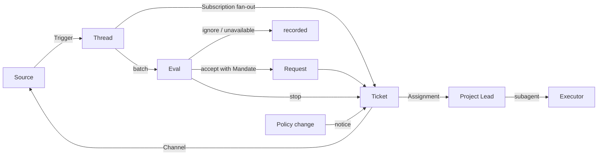

# 001 Domain model

This document names the concepts of dsh-superagent-further and the rules each one keeps. The code, the tools the agents call, the panel and the other documents use these terms and no others. Following [000 Philosophy](000-philosophy.md), the model holds only concepts the work needs, and a business need becomes an attribute of one of them.

## Flow

Work moves from Trigger to Eval to a Request and its Tickets. A Source produces Triggers. A Trigger fans out as context to the Tickets subscribed to its Threads. A person's message that reached a Ticket this way stays with that Ticket; every other Trigger enters Eval, which decides whether it asks for new work. When Eval accepts, it creates a Request with a Mandate: the Request is the ask, and it holds one Ticket per delivery unit. The main Session dispatches each Ticket to its project's Lead; the Lead runs an Executor as its subagent, and results go back to the Source through a Channel. The Request ends when its Tickets do.

## Concepts

Source, Thread, Eval, Mandate, Request, Ticket and Subscription form the core; the rest supports them.

| Concept | Definition | Rules it keeps | Why it exists |
| --- | --- | --- | --- |
| Source | A stream of events. A Source kind is a reusable implementation; a Source instance is one configuration of a kind: whether it runs and what it listens to | Holds its read position and its own bot identity. Defines what counts as an event, including conditions that only hold over time. Drops the bot's own messages and Triggers outside what it listens to before they enter the domain. Translates each Trigger into the Threads it belongs to and the Channel addresses to reply on. A GitHub instance watches every registered project's repository | A restart must not replay events |
| Trigger | One immutable event with the Source's own metadata, such as its actor | Belongs to one or more Threads. Accepting the same Trigger twice creates no second Request or Ticket | The unit of audit and of idempotence |
| Thread | Triggers in time order; the Source defines which Triggers form one Thread | At most one Eval runs on it at a time. It may have several Tickets. It holds its Subscriptions, the running Eval and its Decision history | Gives Eval a consistent view and its context |
| Correlation | The relation between Threads that one Trigger belongs to | Adds context; never routes | Lets Eval follow related evidence |
| Channel | The write side of a Thread; the Source defines its addresses | A Thread may have several Channels; a Ticket holds a set of them | Acknowledgements, replies, pull requests and resolved reviews are all writes |
| Admission | The part of a Source's Policy that decides whether a message may start work: for each receiving scope, who may make an explicit request, who is only an inferred candidate, and what is ignored | A listed person who addresses the agent is explicit without a cell. A follow-up on a Thread that already has a Ticket reaches that Ticket and skips admission. A bot reads the bot list, never the admission table. Part of the Policy version; changing it can revoke a Mandate at revalidation but does not stop open Tickets | Keeps who may ask for work in one place, in each Source's own identities |
| Policy | The versioned rules and each Source's part: its admission table, allowed list and sync, and its bot list | The Policy version covers the accept mode, the rules and the Source parts. A change that bears on a live Ticket, such as a change to a rule it was accepted under, is delivered to its Assignment; it does not revoke Mandates. Identities on different Sources are never mapped to each other | When the rules change, a running Eval must be discarded |
| Accept rules | The named categories of proactive work Eval may accept without an explicit request, each with a stable id, a Chinese name, an instruction and a switch | Ten ship built in; copy and visual are on, the other eight off. A proactive accept needs at least one enabled matching rule; the Mandate records the matched ids and limits the Executor to them. A rule narrows work; it never widens a Mandate or the admission boundary | Lets an operator tune what the agent may start on its own without editing prompts |
| Eval | The judgement on a batch of Triggers, in two layers: gate and assessment | Input: the Trigger batch, a Thread snapshot, every Ticket on the Thread including ended ones, and the current Policy. Output: a Decision. Holds no state. Judges every enabled rule once | Decides whether new work starts, goes on or stops |
| Decision | The result of an Eval: accept, stop, ignore or unavailable, with its strength, its reason and, for an accept, the matched accept rules | `accept` creates one Request with a Mandate and one Ticket per delivery unit; `stop` withdraws a Mandate and ends a Ticket; `ignore` records why nothing starts; `unavailable` means the Eval did not finish and its Triggers are queued again. Only a Decision accepts; a person's stop command ends a Ticket without one | One auditable answer to whether work starts |
| Mandate | What an accept grants: the Policy version, the scope, the strength, the matched rules, the sender's identity on that Source and how the Source received the Trigger | Immutable; wider scope means a new Request or Ticket. One Mandate covers a Request and its Tickets. A Ticket's end does not end it: only a person's stop withdraws it, and a Policy that no longer holds it revokes it. Revalidated against the current Policy before an ended Ticket resumes | States why the work may be done, and how far it may go |
| Request | One accepted ask from one person: its Decision and Mandate, a title, an optional deadline and the Tickets that deliver it, one per delivery unit | Only Eval creates one, one per Trigger batch; only the main Session adds Tickets. Its Tickets form a directed acyclic graph through `after` edges and are dispatched in that order. Ends `done` when every Ticket ends with its result, `partial` when some do, and `stopped` when a person stops it. The person gets one acknowledgement and one result, not one per Ticket | Keeps a multi-part promise as one thing the person can follow |
| Project | A registered local clone paired with a remote `owner/name` repository and an optional base branch; the unit a Ticket's work happens in | A Ticket belongs to exactly one project; the Executor runs in that project's clone and directory. Every registered project is polled. The first registered project supplies the deployment's primary repository: setup verifies push access to it, unqualified `github:<n>` Thread ids belong to it, and other repositories' ids are qualified `owner/name#<ref>`. A request no project can own is refused at acceptance | Separates where work happens from whether it may happen |
| Ticket | A unit of authorized work, and one delivery: a pull request, a review report or an answer | Only an accepted Request creates one. Refers to its Mandate; holds its Channels and Inputs. Goes open → ended, and back to open when a person's message on one of its Threads resumes it, unless a person stopped it. Defines its own state instead of following the Executor's. A ready report without a pull request completes a review, research or read-only Ticket | Owns the execution and its reports |
| Assignment | The binding of a Ticket to one Executor instance | A Ticket has several over time. Goes pending → running → ended independently of the Ticket. Only its final report may end the Ticket on the Executor's side | The Executor is outside the domain, but who executes must be inside it |
| Report | What an Assignment reports to its Ticket: a state, a summary, and evidence such as a pull request or a test run | progress, waiting, ready, blocked, failed or dropped. `progress` is internal and does not end the Ticket; `waiting` asks for a person's answer. A ready report without a pull request ends an `answer` Ticket as completed; a `change` Ticket ends only through the pull requests its report names or its Threads bring in. It cannot end a Ticket a person stopped | Carries the outcome and the evidence to the person |
| Subscription | A many-to-many relation between Tickets and Threads, held by the Thread | A matching Trigger fans out to every live subscribed Ticket, with no check of who sent it; a person's message that reaches a Ticket this way takes no Eval. A Thread an Executor follows for context reaches its Ticket the same way, but lends it no authority and does not resume it. An ended Ticket keeps its Subscriptions, including that of a pull request that closed or merged: a person's message resumes it under the same Mandate, with no Eval or Decision; messages from bots and CI do not reach it, since its Executor reads its Threads again when it resumes. A Ticket a person stopped receives nothing. The main Session attaches a Thread to an existing Ticket only when its message points at that Ticket explicitly. A person can drop every Subscription on a Thread; an Executor can drop only its own Ticket's Subscription to a Thread it finds unrelated, except the Thread its Ticket started on and a Thread a Source made it follow, such as its pull request's | Later discussion reaches the Executor without anyone mentioning the agent again |
| Memory | A fact, decision, preference or lesson that outlives a Session | Written by the main Session (which sees the whole installation) or a project Lead (only its own project) through a tool, or derived deterministically from an ended Ticket or Request; scoped to the installation, a project or a ticket; deduplicated by content; may be pinned or expire. Never a Mandate: a memory grants no authority and is prompt context only | Lets a later Session know what an earlier one learned without replaying the conversation |

A person is not a domain concept. A Trigger carries its actor's identifier as the Source gives it. An allowed list is a Source's part of the Policy, in that Source's identities. That one person has accounts on several Sources is prompt text that the agents read when they need it.

## Roles

Three Session roles carry the work. The Orchestrator and the project Leads appear in the Session list; the Executor runs as a subagent and stays out of it. Assignments connect the Executor to the domain, and every role acts under a Mandate rather than on its own position.

| Role | Session | Rules it keeps |
| --- | --- | --- |
| Orchestrator (main Session) | `orchestrator`, the deployment's main Session | Evaluates Triggers, creates Requests and Tickets, dispatches Tickets to their projects, replies to people and keeps installation-wide Memory. Never executes a Ticket's work or changes a repository. The panel and the user-facing documents call this role the Orchestrator; the code and prompts call the Session `orchestrator` |
| Lead (Project Lead) | `lead-<project id>`, preset `dsh-superagent-further-lead` | One per registered project, persistent while the deployment runs. Receives its project's accepted Tickets from the Orchestrator, starts, steers and settles the Executor subagents, and carries its project's clone, repository and base branch. Reads no admission, Policy or work instructions. Changes no Policy or settings; proposes records instead of writing them |
| Executor | `worker-<ticket id>`, a subagent of its project's Lead | Runs one Assignment in its own Session and directory. Handles a follow-up that reaches its Ticket, or hands it back; reports through its Lead. Never decides authorization, changes a Policy or ends its own Ticket |

Only the Orchestrator writes domain records, and it does so through the Engine. A Lead and an Executor act on what they are given, not on what they would record.

Aggregates: a Source holds its read position. A Thread holds its Subscriptions, its running Eval, which runs serially and merges Triggers that arrive meanwhile into the next batch, and its Decision history. A Request holds its Tickets and their order. A Ticket holds its Assignments, Channels and Inputs, and refers to Decisions by id.

## Admission, accept mode and accept rules

Admission asks whether a message may start work at all. Each Source's Policy holds an admission table whose rows are the Source's receiving scopes, such as a Feishu chat, a direct message, a new Issue, a comment or a CI change. A cell classifies a message by whether its sender is on the allowed list and whether it addresses the agent: an explicit request, an inferred candidate or ignored. A listed person addressing the agent is explicit without a cell; a follow-up on a Thread that already has a Ticket reaches that Ticket's Executor and skips admission. Two cells stay inactive until the Source receives messages that do not address the agent: a listed person not addressing, and an unlisted one not addressing. CI has no sender, so only the last cell applies. A bot reads the bot list, never the admission table. The table is part of the Policy version; weakening it does not stop open Tickets, but a Mandate is revalidated against it before an ended Ticket resumes.

The accept mode decides what an inferred case may become: `off` turns every inferred case away before it becomes a candidate; `observe`, the default, assesses it and records a positive assessment as an ignore marked "would accept"; `auto` accepts a candidate that matches at least one enabled rule. An explicit request is handled as a request in every mode.

| Rule | 中文 | Shipped | What it accepts |
| --- | --- | --- | --- |
| copy | 文案纠错 | on | Misspellings, wrong or stale wording and broken formatting in text a person reads |
| visual | 视觉修正 | on | Misalignment, overflow and inconsistent spacing or colors in a view |
| bugfix | 缺陷修复 | off | A failure with a reproduction and an expected behavior |
| feature | 功能实现 | off | A small, clear addition with an objectively checkable result |
| docs | 文档/配置/脚本 | off | Wrong or missing documentation, configuration or scripts |
| tests | 测试与 CI 修复 | off | A failing test or CI job with a known fix |
| refactor | 重构/性能 | off | A named structural or performance problem with a measurable improvement |
| research | 调研与报告 | off | A question answerable by reading code and documentation, delivered as a report |
| review | 审查（全仓或局部变更） | off | A review of the whole repository or a named change, delivered as findings with evidence |
| qa | 只读调研问答 | off | A question answerable without changing any file, delivered as an answer |

Every category shares one admission boundary: the intent and a deliverable must be clear, and the goal objectively checkable. A clear request is accepted even when details are unsettled; the Executor pins the scope with one question in the Ticket and never expands it. Review, research and read-only answers end with a ready report and its evidence: the Ticket completes without a file change, branch or pull request, and the acknowledgement names the review or answer. A rule may set process or communication requirements for its Ticket's Executor, but team-wide requirements belong in prompt sections. Two candidate categories are documented but not active: 更改 SuperAgent 配置 and 项目 dsh 自动化任务.

## Context the Sessions carry

Beside domain records, every decorated Session receives a runtime-context snapshot before each model request.

| Context | Definition | Rules it keeps |
| --- | --- | --- |
| Language | The default language for text a person reads, set in Settings → Language | Free text, panel-only and revisioned. Carried in the runtime-context snapshot and applied on the next request. A reply on Feishu or GitHub follows the language of the message it answers; pull request bodies, commit messages, code comments and file contents keep the repository's language |
| Skill | Prompt text that teaches a way of working, such as the built-in Feishu and GitHub skills or a team's own | Read-only text in the prompt. Grants no authority and may not override a Policy or a Mandate |
| Runtime context | The snapshot rebuilt for each model request from the current Memory, Language and project facts | Appended after the cached history so a change applies without a restart or a prompt rewrite. Grants nothing; a memory or a language is context, not permission |

## Rejected concepts

| Rejected | Reason |
| --- | --- |
| Principal or Membership as an entity, or mapping identities across Sources | A person is Trigger metadata; an allowed list is a Source's part of the Policy; a cross-Source mapping is prompt text |
| Eval scheduling its own delayed Triggers | A condition that needs waiting is an ordinary Source, so Eval never depends back on Sources |
| Waiting or revoked Eval states | Waiting belongs to Sources; an Eval that runs out of time queues its Triggers again, or ends `unavailable` |
| At most one live Ticket per Thread | One Thread can carry several independent pieces of work; the assessment avoids duplicates from the Ticket list |
| An "append to Ticket" Decision | Appending is Subscription fan-out and needs no Eval |
| Admission checks on Subscriptions | A Subscription covers the whole Thread; the Mandate separates authorization from context |
| Correlation that routes | Subscriptions route; Correlation only adds context |
| Ticket state that follows the DSH Session | A Ticket can be handed off, resumed, or run by several Executors, so it defines its own state |
| An Executor declaring that a person asked it to stop | Only Eval decides the strength of an end |
| Cancelling running Tickets on a Policy change | A cancelled change leaves half-finished work; the change is recorded and delivered instead |
| Locking all of an Executor Session's tools when it fails or blocks | It would refuse a person working directly in the Session, and the report after recovery; pausing automatic input is enough |
| Inferring "waiting on a person" from a report's free text | The classification needs structured facts; the Executor asks through a structured field |
| A GitHub Source setting that names the deployment's repository | The first registered project supplies the primary repository; a second setting would disagree with it, and moving a project would leave the watcher behind |
| An `executor.orchestration` switch | A Ticket always runs under its project's Lead, and a request no project can own is refused; one execution path, with no fallback |
| A Lead that writes domain records | Only the Engine writes; the Lead starts, steers and settles its project's executors for the Orchestrator, so recovery and audit keep one writer |
| A Memory, a Skill or an accept rule that grants authority | Authority is the Mandate; context and rules only narrow what an Executor may do under one |
| A Project that decides authorization | The project decides where work happens; the Mandate decides whether it may happen |
| Language detection or a post-generation language check | The default language, the reply-follows-message rule and the repository-language rule are prompt context; nothing detects or rewrites a language |
| A root-Session execution path for a Ticket without a project | Onboarding requires a project; a request no project can own is refused at acceptance, pointing at Execution → Projects |

## What is reusable

The concepts above and their rules are reusable. The Source implementations, the Policy contents, the Session layouts, the Executor and the Channel implementations belong to a deployment. Each Source keeps its own words internally, such as message, chat or notification, and translates them into Triggers.

| Part | In this repository |
| --- | --- |
| Source | Feishu: live events, history recovery, polling of subscribed topics. GitHub: notifications, subscribed Issues and pull requests, CI changes, pull requests merged or closed, and, where switched on, every new Issue, pull request and comment in every watched repository and the default branch's CI. The first registered project's repository is the primary repository; other projects' Thread ids are qualified `owner/name#<ref>` |
| Project | The Execution settings list: each project's local clone, `owner/name` remote repository and optional base branch; the first registered project supplies the primary repository |
| Policy | The accept mode and the ten accept rules, and each Source's admission table, allowed list, sync and bot list |
| Executor | A project Lead Session per project that runs each Ticket's Executor as its own subagent, plus one Executor Session and directory per Ticket, in an execution environment whose variables the Executor and the Sources register |
| Channel | Feishu topic replies, GitHub comments and review thread replies |
| Roles | The Orchestrator main Session, one Lead per registered project, and one Executor subagent per running Ticket |

## Glossary

A reference list of the terms this and the later documents use, with their Chinese names; the later documents explain the terms not introduced above. The panel shows one language at a time; its (?) button opens this glossary with both languages. The messages agents send to people on GitHub and Feishu use plain language, not these terms.

| Term | 中文 | Meaning |
| --- | --- | --- |
| Agent | 智能体 | The automated team member dsh-superagent-further runs, acting on Sources through identities such as a GitHub account and a Feishu bot |
| Session | Session | A DeepSeek Harness conversation with its own context and tools; the Orchestrator, each Lead and each Executor run in one |
| Main Session | 主 Session | The DSH Session that evaluates Triggers, creates Requests and Tickets, dispatches Tickets and replies; the role the panel calls the Orchestrator, `orchestrator` in code and prompts |
| Lead (Project Lead) | 项目 Lead | The DSH Session that runs one project's Tickets for the Orchestrator; `lead-<project id>` in session storage, preset `dsh-superagent-further-lead` |
| Executor Session | 执行器 Session | The DSH Session an Executor runs for one Ticket; `worker` in code and prompts. Under a Lead it is a subagent of that Lead Session and stays out of the Session list |
| Source | 来源 | A stream of events: a kind that a plugin provides, plus one instance configuration |
| Trigger | 触发 | One immutable event from a Source |
| Thread | 线程 | Triggers in time order; the unit within which Evals run one at a time |
| Correlation | 关联 | The relation between Threads that share a Trigger; it adds context only |
| Channel | 渠道 | The write side of a Thread |
| Admission | 准入 | The part of a Source's Policy that classifies a message per receiving scope as an explicit request, an inferred candidate or ignored |
| Policy | 策略 | The versioned rules for accepting work, and each Source's part of it, such as who may ask for work there |
| Policy version | 策略版本 | The identifier of one combination of rules, Source parts and accept mode; every Mandate records it |
| Accept rules | 接单规则 | The named categories of proactive work the agent may accept, each with an instruction and a switch; part of the Policy version and recorded in a Mandate |
| Accept mode | 接单模式 | What happens to an inferred case: nothing, a recorded assessment or an accepted Request; part of the Policy version |
| Eval | 评估 | The process that turns a batch of Triggers into a Decision |
| Gate | 准入判定 | The deterministic first layer of Eval: who may originate work, and with what strength |
| Assessment | 研判 | The model's judgement during Eval |
| Decision | 决定 | The result of Eval |
| Mandate | 授权 | What an accept grants: strength, scope and the Policy version it relied on |
| Request | 请求 | One accepted ask: its Decision, Mandate, title, optional deadline and the Tickets that deliver it |
| Project | 项目 | A registered local clone paired with a remote `owner/name` repository and an optional base branch; a Ticket belongs to one |
| Primary repository | 主仓库 | The first registered project's repository; setup verifies push access to it and unqualified `github:<n>` Thread ids belong to it |
| Ticket | 工单 | A unit of authorized work and one delivery |
| Assignment | 派工 | The binding of a Ticket to one Executor instance |
| Report | 报告 | The state an Assignment reports to its Ticket, with its evidence |
| Subscription | 订阅 | The relation between a Ticket and a Thread |
| Fan-out | 扇出 | Delivering Triggers of a subscribed Thread to a Ticket as context |
| Executor | 执行器 | The port that runs Assignments: one Executor Session and one directory per Ticket, under the project's Lead |
| Execution environment | 执行环境 | Where Executor Sessions and the prepare command run: variables that the Executor and the Sources register, each with a key, a value and a description |
| Memory | 记忆 | A fact, decision, preference or lesson that outlives a Session and becomes prompt context |
| Language | 默认语言 | The operator's default language for text a person reads, carried in the runtime-context snapshot |
| Skill | 技能 | Prompt text that teaches a way of working; it grants no authority |
| Runtime context | 运行时上下文 | The snapshot rebuilt before each model request from Memory, Language and project facts |
| Deployment | 部署 | One installation: its state directory, Sources, Policy, prompts, projects and panel |
| Attention | 待人工决定 | A question on a Ticket that waits for a person's answer |
| Disposition | 去向 | The record of a Trigger being filtered, evaluated or fanned out |
| Input | 输入 | Context delivered to a Ticket: fanned-out Triggers, Policy changes, resumes and text |
| Scope | 范围 | The work a Mandate allows |
| Strength | 强度 | How strong the basis of a Mandate or an Eval is |

| Group | Values |
| --- | --- |
| Decision | accept 接单 · stop 停止 · ignore 忽略 · unavailable 未完成 |
| Strength | explicit 明确 · inferred 推断 |
| Ticket | open 进行中 · ended 已结束 |
| Assignment | pending 待启动 · running 执行中 · ended 已结束 |
| Report | progress 进展 · waiting 等待 · ready 就绪 · blocked 受阻 · failed 失败 · dropped 无需处理 |
| Request | done 完成 · partial 部分完成 · stopped 已停止 |
