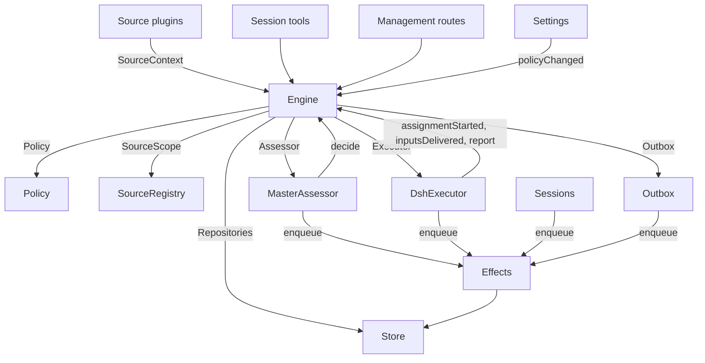

# 007 Architecture

This is the developer guide to the implementation. It maps the concepts in [001 Domain model](001-domain.md) through [006 Deployment](006-deployment.md) to classes, interfaces and files. Start with the runtime and Engine, then use the module and test tables as a code index.

The Orchestrator and the main Session are the same Session: the documents and the panel call it the Orchestrator, and the code and prompts call it `orchestrator`.

## Core classes and glue

Core classes own domain concepts and external boundaries behind small interfaces. Glue translates tool arguments, HTTP requests, Source payloads and DeepSeek Harness events into calls to those classes, then turns results into cards, views and messages.

`Runtime` (`src/app/runtime.ts`) constructs the application, supplies dependencies, and owns startup and shutdown. `Engine` constructs its own internal parts. The Executor and Assessor call back into the Engine, so Runtime gives them getters rather than requiring construction in a circular order.

### Runtime

`Runtime` is the composition root; it contains no domain rules. Its constructor locks the state directory, opens the Store and builds each component. If construction fails, it closes the Store and releases the lock.

Startup registers management routes and runs Setup. Setup prepares the mandatory Orchestrator workspace first, then the projects, accounts and worker environment; only after it resolves does startup register the workspace with DeepSeek Harness under its explicit title, retire the legacy master id and its `stateDir` registration when the workspace changed (best-effort: a failure is logged and startup continues with the old Session and registration intact and readable), unarchive the returning workspace's own archived master when it was used before (an unarchive failure fails startup with `workspaceUnsafe`), install Session and Executor hooks, ensure the main Session in that workspace, start Policy syncs, resume interrupted Assignments, and start passes and effects. A failed setup leaves the runtime paused at `setupPending` before any of those steps: no workspace registration, no master Session, no Source polling and no Executor. `ready` marks completion of startup.

Shutdown cancels turns, waits for passes, effects and agents, restores the process environment, closes the Store and releases the lock. Source plugins inject Runtime as the `orchestrator` service through the narrow `SourceHost` interface.

### Platforms

dsh-superagent-further runs on macOS, Linux and Windows 10/11, with each platform difference behind one module:

- **Absolute paths** (`src/infra/paths.ts`): the plugin `Config` schema accepts a drive-letter, UNC or root-relative path on Windows and a POSIX path elsewhere, and `policy.ts` applies the same rule to the Executor directory. The rule is a schema pattern rather than `path.isAbsolute`, which would accept the other platform's syntax.
- **Batch-file CLIs** (`src/infra/batch.ts`): Windows starts a `.cmd`/`.bat` program only through `cmd.exe`, and Node cannot start one with an argument array at all. `Commands` builds that invocation with `cmd.exe /d /s /c` plus `windowsVerbatimArguments` and refuses an argument `cmd.exe` would rewrite (a `%VAR%` naming a variable in the CLI's environment, or a line break; a percent pair naming no variable, such as an encoded `%3A`, passes through unchanged); comment bodies and Feishu replies travel on the CLI's stdin (`gh api --input -`, `lark-cli --markdown -`) because they carry newlines; the Feishu event consumer starts its CLI the same way and ends the whole process tree when it stops.
- **Worker environment** (`src/infra/environment.ts`): the `worker-bin` shims are batch files on Windows and `#!/bin/sh` scripts elsewhere, `PATH` is split with `path.delimiter`, and the git credential helper is compared in git's normalised `-z` form.
- **Shell tool**: both presets install `bash` and `pwsh`; the main Session's allow list keeps the platform's shell (`src/app/sessions.ts`), and the Executor's prepare command runs through `sh -c` on POSIX and `pwsh -NoProfile -NonInteractive -Command` on Windows.
- **Service lifecycle** (`scripts/dsh-superagent-further`, `scripts/dsh-superagent-further.cmd`): a dependency-free Node script with no Python or tmux, using `Get-CimInstance Win32_Process` for discovery on Windows and `ps -ww` elsewhere. A graceful stop asks the runtime over `POST /orchestrator/api/shutdown`, because Windows cannot deliver a graceful signal to a detached process; only when the route is missing does it fall back to `SIGINT` on POSIX or `taskkill /T` on Windows.
- **Owner-only state** (`src/infra/acl.ts`): POSIX modes restrict nothing on Windows, so the state directory and database get an `icacls` ACL that grants only the operator's account.

| Part | Module | Does |
| --- | --- | --- |
| Setup | `src/app/setup.ts` | Resolves the accounts by probing their CLIs the way worker shells run them, and the primary repository as the first registered project's, writes and applies the workers' environment and command shims, and keeps the setup problems; Settings checks a changed account through it, and restarts through it, which runs setup again |
| Workspace | `src/app/workspace-root.ts` | Validates and prepares the mandatory Orchestrator workspace (absolute path, canonical realpath, empty or marked directory, owner-only, no overlap with the state directory, the DSH home and profile, the package checkout or a project workspace), titles and registers it as a DSH workspace, and retires a legacy master id and its `stateDir` registration without deleting a Session |
| Passes | `src/app/passes.ts` | One pass at a time, every two seconds and whenever a command asks: the due effects, then `Engine.evaluateDue`; a Source's Trigger reaches the Engine through it |
| Outbox | `src/app/outbox.ts` | The Engine's `Outbox` port, and the only writer of the receipts: `send` keeps a message's receipt and queues its `reply` effect in one transaction, and the effect's handler sends it through `SourceRegistry.send`; a message waits while its Source is off, and is dropped when the conversation is gone or not listened to |
| Notices | `src/app/notices.ts` | Converts domain events and worker activity into main-Session messages. `eventNotice` handles domain notices; `reportRelay` forwards questions immediately, keeps ordinary progress on its Ticket, and relays other reports; `followupRelay` names the Tickets that own a human follow-up. Relays arriving during a turn are delivered together at its next step through the DeepSeek Harness inbox |

### Engine

`Engine` (`src/core/engine.ts`) is the only writer of Triggers, Threads, Decisions, Tickets and Assignments. It receives these ports from `src/core/ports.ts`: `Repositories`, a current-Policy getter, `SourceScope`, `Assessor`, `Executor` and `Outbox`. Optional dependencies are `prepareTicket`, `now`, `emit`, and the `projectRequests` repository that only a repository storing project requests provides.

All Engine methods are synchronous. Each command changes its aggregates in one transaction. `evaluateDue` uses a separate transaction for each Eval or Ticket it changes. Ports enqueue external work inside the transaction; adapters perform it after commit. Invalid requests throw `UserError`, except the project-request commands, which throw `ProjectRequestError`.

The Engine exposes one entry point and delegates to five internal parts. It owns each command's transaction. Commands spanning parts, such as `attach`, `evaluateDue` and `policyChanged`, call the parts in sequence.

Each part extends `EnginePart` (`src/core/part.ts`), which provides options and shared reads. Dependencies between the parts flow in one direction:

| Part | Responsibility | Depends on |
| --- | --- | --- |
| `Intake` | A Source's Trigger: stored once with its disposition, recorded on its Threads and their correlations, fanned out to the subscribed Tickets and, unless it is a person's message that reached one, queued for Eval on its primary Thread | Tickets |
| `Evals` | The Evals of Threads: batching, the gate's strength, actor and basis with the Trigger that gave them (`primary`), the deadline from the candidate's delivery and its shift by a pause, the requeue of an expired Eval, candidates, replays and hand-backs, the requeue on a Policy change, and the Decision each ends with: accept, stop, ignore or unavailable | Tickets |
| `Tickets` | The Ticket lifecycle: creation from an accept with its Mandate, Subscriptions and first Assignment, the Threads it follows and their closes (`followsDone`), attached Threads and Threads followed for context, Inputs and notes, resume and the messages a resume refuses, retry, restart, stop and end with its `by`, `cause` and `outcome`, the Subscriptions it drops, and the notice of a Policy change to the Tickets it bears on | Replies |
| `Assignments` | What the Executor and its workers report: an Assignment started, Inputs reached it or failed to, a restart interrupted it, and a worker's Report with its question for a person; a ready Report on an `answer` Ticket or a dropped Report ends the Ticket with cause `report` | Tickets, Replies |
| `Replies` | Channel writes through the `Outbox`: the acknowledgement, the answer, the result, the attention message, and the one notice that answers a whitelisted explicit Trigger a Decision left unsettled, each by the rule that allows it | Nothing |

Project requests do not need a part: they live in the optional `projectRequests` repository. `raiseProjectRequest` records a worker's ask, and the Lead commands list, reply to, decide, plan, request approval for and complete one. They refuse with `ProjectRequestError` while that repository is absent, the request is unknown, or the change does not fit its status. A `disposeProjectRequest` accept records the decision and, in its `notes`, the statement and deliverables the Lead planned. It also acts: a work request raised from a root Thread creates its domain Request and staged Tickets under a Lead Mandate, while an architecture request creates one standalone design Ticket (no domain Request yet) whose worker produces the decision document or plan (docs/012-project-requests.md D7). `planProjectRequest` stores the structured statement and deliverables before the accept so the Tickets are staged with their `after` edges. `requestProjectApproval` requires the accepted architecture request's design Ticket to have ended, takes its proposal from the design worker's latest report, moves the request to `awaiting-approval` and emits `project-request.approval-requested`. `approveProjectRequest` records a person's answer only from a human Trigger on the root Thread written after the proposal: a rejection records it and ends the request `rejected`, while an approval creates the implementation Request and its staged Tickets under the same Lead Mandate. `completeProjectRequest` ends an accepted or approved request as `completed`, appends the Lead's summary and emits `project-request.completed`; the Runtime turns that event into one aggregate report through the root request's origin Channels (docs/012-project-requests.md D6).

Commands use imperative names such as `stopTicket`; facts reported by adapters use past-tense names such as `assignmentStarted`. The query `candidate` uses a noun.

Callers receive only their role's `Pick` of the Engine: `EngineForSources`, `EngineForMainSession`, `EngineForPeople`, `EngineForSettings` or `EngineForExecutor`. A project Lead calls the project-request subset of `EngineForMainSession` through `src/app/lead-dispatch.ts`, and the architecture approval commands through `EngineForLeadApprovals` bound into the Lead tools; they are the same commands the main Session uses, not a sixth role.

| Role | Method | Effect |
| --- | --- | --- |
| Sources | `receive(trigger)` | Stores a Trigger once and answers `stored`, `duplicate`, or `filtered` when no Source receives it; fans it out to the Tickets subscribed to its Threads, where a person's message resumes an ended Ticket at once unless processing is paused, and queues it for Eval on its primary Thread, unless it is a person's message that reached a Ticket, which stays that Ticket's |
| Sources | `bindThread(ticketId, thread, own)` | Makes an open Ticket follow one of the Source's Threads, such as a pull request's, `own` when the Ticket opened it; a closed Thread bound again is open again. The Threads' closes, not a `ready` Report, end the Ticket |
| Sources | `threadClosed(thread, outcome, at)` | A Thread closed: each open Ticket that follows it records the close, and ends once it is done with the Threads it follows (`followsDone`): no Thread it opened is open, or, when it opened none, every Thread it follows closed. It ends `merged` or `closed` as the latest of those closes did, unless work resumed after the close has not reported `ready`, or its Executor took up, by acknowledging or answering it, a person's follow-up it decides after its latest Report other than `progress`, or the end of its last turn; a `dropped` Report then ends it as the close did |
| Main Session | `candidate(triggerId)` | The Eval that holds a Trigger, as its assessor sees it |
| Main Session | `candidateDelivered(evalId)` | The Eval's candidate reached the main Session: its deadline counts from now |
| Main Session | `decide(triggerId, outcome)` | Records an Eval Decision, or a direct Decision for an explicit request. Accept creates the Ticket, Mandate, Assignment, Subscriptions and acknowledgement atomically. An inferred candidate ignored from its card records `ignoredFromCard` before the supplied reason. While `followupOwners` still owns a human follow-up, only stop is allowed. An ignore, unavailable or stop Decision also answers each Trigger of a whitelisted sender's `@` mention or direct message with one notice on that Trigger's Channel, unless the sender was not listed or the message was not addressed (docs/012 D8; idempotent id `explicit-reply-<decisionId>`) |
| Main Session | `attach(ticketId, triggerId, note?)` | Routes a Trigger to a Ticket it points at, whose Executor then decides it as a follow-up, and ends the Eval that holds it, whose other Triggers wait for a fresh Eval; an ended Ticket resumes under its Mandate at once unless processing is paused. A follow-up an Executor still decides is refused, as is one routed back to the Ticket that handed it back |
| Main Session | `requestStatus(ticketId)` | Asks a waiting Executor Session for its status, and answers whether it asked |
| Main Session | `note(ticketId, text)` | Gives a Ticket's Executor a fact from other work as a text Input, which grants nothing |
| Main Session, Executor | `reply(request)` | Queues a message for the Channel its purpose names: `acknowledgement`, `answer`, `result` or `attention` |
| Main Session, Lead | `listProjectRequests(filter?)` | The project requests the Lead may answer, optionally narrowed by `project` and `status`, oldest first |
| Main Session, Lead | `replyProjectRequest(id, reply)` | Appends a Lead's reply to a request still open (`projectRequestOpen`), oldest first |
| Main Session, Lead | `disposeProjectRequest(id, disposition)` | Answers a pending or `needs-info` request with a non-empty text and an `accept`, `reject` or `needs-info` decision, which it records after the reply. An accept for a work request raised from a root Thread creates the domain Request and its staged Tickets under a Lead Mandate; an architecture accept creates one standalone design Ticket |
| Main Session, Lead | `planProjectRequest(id, plan)` | Stores the statement and up to eight deliverables, with their `after` edges, before an accept so the created Tickets are staged (docs/012 D7) |
| Main Session, Lead | `requestProjectApproval(id)` | For an accepted architecture request whose design Ticket ended: records the design proposal from the worker's latest report, moves the request to `awaiting-approval`, and emits `project-request.approval-requested` so the Runtime asks the root Channel |
| Main Session, Lead | `approveProjectRequest(id, input)` | Records a person's `approved`/rejected answer only from a human Trigger on the root Thread written after the proposal; approval creates the implementation Request and its staged Tickets under a Lead Mandate, rejection ends the request `rejected` |
| Main Session, Lead | `completeProjectRequest(id, summary)` | Completes the work of an accepted or approved request with the Lead's summary, and emits `project-request.completed` so a root request's chain is reported once through its origin Channels (docs/012 D6) |
| Executor | `raiseProjectRequest(input)` | Records a worker's project request, or answers the open request that the same Ticket already has under the same project and title |
| People | `stopTicket(ticketId, reason?)` | A person's stop, which withdraws the Mandate |
| People | `retryTicket(ticketId)` | Ends the stalled Assignment of a Ticket that waits for a person after a `failed` or `blocked` Report, or whose Input delivery failed (`canRetry`), and starts a new one |
| People | `reevaluate(triggerId)` | Queues a stored Trigger for a fresh Eval |
| People | `unsubscribe(thread)` | Drops every Subscription on a Thread, and the Tickets that followed it follow it no more; each keeps deciding the follow-ups it received there |
| People | `dismiss(decisionId)` | Dismisses the problem an `unavailable` Decision shows, which the Decision records |
| Executor | `assignmentStarted(ticketId, assignmentId)` | An Assignment runs; its waiting Inputs go out |
| Executor | `inputsDelivered(ticketId, assignmentId, inputIds)` | Inputs reached the Assignment's Executor Session, where each waits for a step to take it |
| Executor | `inputsRead(ticketId, inputIds)` | The Executor Session took the messages that carry these Inputs into its history (a `user/message` Session event), from which its model has them; a step that claimed them and was cancelled or failed before does not count. Each counts as read once a Report or the end of a turn follows, also after a restart, and its Ticket's end does not let go of it; an Input delivered before reads were recorded counts as read once a Report or the end of a turn followed its delivery |
| Executor | `turnEnded(ticketId, assignmentId)` | A turn of the Executor Session ended, also after a Report, once nothing runs for it in the background or as it hands off to a person. What a step took before, it read (`inputsRead`) |
| Executor | `deliveryFailed(ticketId, assignmentId, error)` | Delivering Inputs failed; the Ticket shows it until a delivery succeeds, a new Assignment starts or the Ticket ends |
| Executor | `report(ticketId, report)` | Records a Report and its question for a person; `dropped` ends the Ticket; `ready` on an `answer` Ticket completes it, while a `change` Ticket ends only through the Threads it follows and a ready report without a pull request is refused (`changeNeedsPullRequest`), recording the pull request it names |
| Executor | `markUnrelated(ticketId, thread, reason)` | Drops only that Ticket's Subscription to an attached Thread it found unrelated, and hands back, with the reason, the follow-ups there that the Ticket decides |
| Executor | `followForContext(ticketId, thread)` | Subscribes an open Ticket to a related Thread for context: its messages reach the Ticket but lend it no follow-up strength and do not resume it |
| Executor | `handback(ticketId, triggerId, reason)` | Records that the Ticket hands back a Trigger that reached it, with the reason its candidate carries, and queues it for a fresh Eval once no other Ticket decides it, if this Ticket did; it answers whether it queued it. A Ticket hands back each Trigger once and keeps its Subscription |
| Executor | `assignmentInterrupted(ticketId, assignmentId)` | An Assignment was running when the host stopped: one interrupted mid-work, or one that received an Input after its latest Report, starts again with a recovery note and the Inputs delivered to it that its Executor Session did not take, as a retry does; one that had reported since keeps its Session. The DshExecutor reports each at start (`resume`), oldest Ticket first, and queues again a launch that waits |
| Passes | `evaluateDue()` | Unless processing is paused: starts the Evals of the Threads whose queued Triggers wait, one per Thread with the Triggers queued meanwhile as one batch; queues the Triggers of an Eval past its deadline again, twice in a row, and records it `unavailable` the third time; and resumes the ended Tickets a person's message reached during a pause, if their Mandates still hold. An Eval whose candidate has not reached the main Session does not expire. While processing is paused, no Eval expires, and once it resumes each deadline moves later by the pause's length |
| Settings | `policyChanged(from, to, effects)` | Tells each live Ticket the change bears on how (`policyEffects` in `src/policy.ts`: a rule it was accepted under changed or no longer applies, its requester may no longer start work, or proactive work is no longer accepted), and restarts the Evals in progress under the new version |

The Engine keeps batching, authorization, fan-out, resume and attention lifecycle rules private. Several shared predicates make these rules consistent:

- `waitsForPerson` (`src/core/model.ts`): the latest Assignment reported `blocked` or `failed`, and no human message has arrived since. Automatic Inputs and failed launches remain held while this is true.
- `followupOwners`: the Tickets still responsible for a human follow-up received on their own Threads. A Ticket can be live or ended without a human stop and waiting to resume. Handing back the message ends that ownership.
- `settled`: a Decision resolved the request; stop, unavailable, routed and refused-stop Decisions do not count.
- `ticketStage` (`src/core/stage.ts`): implements the stage table in [003 Execution](003-execution.md).

When a Ticket ends, unread follow-ups return to Eval unless another Ticket still owns them or another disposition settled them. Acknowledged, answered and handed-back messages are excluded. For older records without acknowledgement dispositions, the outbox receipt supplies that fact. A final Report also covers messages waiting when the Assignment began, including the message that resumed it. The message that stopped a Ticket is not automatically re-evaluated.

After a change, the Engine emits an event from `DomainEvents` in `src/core/ports.ts`:

`trigger.received`, `eval.started`, `decision.recorded`, `ticket.created`, `ticket.resumed`, `ticket.ended`, `request.ended`, `project-request.completed`, `project-request.approval-requested`, `assignment.started`, `assignment.ended`, `thread.subscribed`, `thread.unsubscribed`, `trigger.requeued`, or `policy.changed`.

Runtime turns `ticket.ended`, `trigger.requeued` and `thread.unsubscribed` into notices. A human `trigger.received` delivered to Tickets becomes a follow-up relay. `pullEndNotices` sends one chat notice, using a stable id, when a Ticket ends merged or closed. `requestResultNotices` reports a domain Request whose delivery spans several Tickets once per non-GitHub Channel. A `project-request.completed` event builds the aggregate report of the completed root request and its whole derived chain through the root's non-GitHub origin Channels, delivered once per Channel under a stable id built from the root id; a completed derived request reports nothing of its own. A `project-request.approval-requested` event sends the design proposal to the root request's origin Channels under the stable id `project-approval-<requestId>`, asking the person to approve or say what should change. A human `trigger.received` on the root Thread of an `awaiting-approval` request written after its proposal also prompts that project's Lead to call `lead_request_approve`, so the answer is linked and recorded (docs/012 D7). Other events currently have no consumer.

### Model

`src/core/model.ts` holds the domain types, and `src/core/stage.ts` the Ticket stages. A Decision records why as `reason`, a list of `Reason`s (`src/core/reasons.ts`): each a `code` with its `values` and, for one Trigger of a batch, its `triggerId`.

The core's codes, such as `timeout`, `policyChanged`, `routed` and `startedTicket`, are `REASONS`, with the English that agents read through `reasonText`; a gate or a Source scope gives its own, such as `not_a_member`; and `said` carries words an assessor or a person wrote. The panel words each code by `reason.<code>`, and a Trigger a Source filtered records the Source's code the same way.

A Ticket keeps each fact once. It is open while it has no `ended`; the end records `at`, `by` (`TicketEndBy`: `executor` when the worker's report or a followed pull request ended it, `human` for a person's stop or an Eval's), `cause` (`TicketEndCause`: `report` for the worker's own ready or dropped Report, `human` for a person's stop, `merge` for a followed pull request's close, `eval` for an Eval's stop), `outcome` (`TicketOutcome`) and an optional `reason`. What it last said is its latest Assignment Report (`latestReport`); and its Executor Session is named after it (`workerSessionId` in `src/executor/dsh.ts`).

Its fields are typed: `deliverable`, the contract the accept named (`change` opens a branch and ends only through a pull request, `answer` reads the live checkout and ends with its ready report); `origin`, the admissible Trigger that gave its Eval's batch its strength and the batch itself (`triggerId`, `triggerIds`); `execution`, what the Executor chose (`name`, `directory` and `assignment`); `delivery`, the last failed Input delivery (`error`, `at`), until a delivery succeeds, a new Assignment starts or the Ticket ends; and `follows`, the Threads a Source made it follow, each `{thread, own, closed?}`: `own` when the Ticket opened it, and `closed` with `at` and `outcome` once it closed. Tickets alone writes `follows`; the GitHub Source reads its pull requests with `pullsOf` and `pullOf` (`src/sources/github-pull.ts`).

An Assignment is one worker's run of a Ticket. `Assignments.report` stores the Report that may end the Ticket, and it ends it with `by: 'executor'`, `cause: 'report'`, the outcome and the Report's time, inside the recording transaction. `Tickets.end` uses `cause: 'merge'` when a followed pull request closes the Ticket, and `by: 'human'` with `cause: 'human'` or `'eval'` when a person or an Eval stops it. `Executor.stop` receives that cause, or `'retry'` for an Assignment that ends without ending the Ticket, so the Executor never infers from a Report's timestamp whether it owns the teardown.

An Input that carries a Trigger records whether a person wrote it, which `waitsForPerson` reads. A Thread also lists in `context` the subscribed Tickets that follow it only for context, and counts in `expired` the Evals of its queued Triggers that expired in a row; an Evaluation records its `primary` Trigger and when its candidate was `delivered`.

A Trigger's disposition records the Tickets it reached, by fan-out or attachment, a person's requeue, each Ticket that handed it back, with the reason, and each Ticket whose Executor acknowledged or answered it.

A project request (`ProjectRequest`) records work asked of a project rather than of one Trigger: its `project`, `kind`, `title`, `instruction`, who raised it (`raised_by`, with its Ticket and Assignment when a worker did), its `status`, the Lead's `replies` oldest first, its `decision`, the domain Request an acceptance created (`request_id`), the `tickets` it covers, the `derived` requests that name it as root, the human `approval` an architecture request needs, and for the architecture flow the structured `plan` the Lead stages, the standalone `design_ticket_id` and the `proposal` (its time, Ticket and text) sent for approval. An approval records `approved: false` when a person rejected; its absence means approval. A root request also records where it came from in `root` (`request_id`, `trigger_id`, `thread_key`), while a derived request points at its root through `root.project_request_id`; `projectRequestOpen` says whether the Lead may still answer it. Its refusals are `ProjectRequestError` codes.

A Mandate's `basis` (`MandateBasis`) records how the gate admitted its Trigger. Revalidation reads the receiving `source`, `scope` and `row`, the listed `sender`, matched `rules`, and `via`:

| `via` | Admission basis |
| --- | --- |
| `addressed` | An allowed sender addressed the agent |
| `followup` | A message arrived on a Thread with Tickets |
| `admission` | An admission-table cell; `observation` marks an inferred candidate |
| `lead` | The basis an accepted project request records: its `project` and `project_request_id` name the work |
| `installation` | An installation automation delivery raised the work, with no Source message; revalidates like an internal accept |
| `discovery` | The Orchestrator's own finding about superagent itself, raised with no Source message and no automation; revalidates like an installation accept |
| `bot` | A listed bot produced an inferred candidate |

Trigger and Thread `meta` belong to the Source. The core does not interpret them.

### Policy

`src/policy.ts` defines settings schemas, authorization and assessment rules. `DEFAULT_RULES` holds the sixteen built-in rules, named and worded in Chinese and all enabled, so a fresh installation assesses every category; the operator can switch any category off. `LEGACY_DEFAULT_RULES` keeps the old English text, and `upgradeRules` translates an existing installation's untouched built-ins while preserving operator edits; a stored set that is still exactly the 0.3.0 defaults, the untouched legacy pair, the earlier twelve-category set or the earlier fifteen-category set is replaced by the current sixteen-rule set. The rules are normalized whenever settings are parsed, so no schema step is needed. `settingsPolicy(settings, scope)` returns a fresh, stateless `Policy` on each use:

- `version`, `paused` and `evalTimeoutMs` describe its current state.
- `gate(trigger, thread, tickets)` returns admission strength and basis.
- `revalidate(mandate)` checks whether an existing Mandate still holds.
- `admitsInferred(rules)` permits proactive acceptance only in auto mode with enabled matching rules.

`assessmentOutcome(assessment, settings, strength)` converts the model's assessment to an Engine outcome. It requires a judgement for every enabled rule, settled direction, a matching rule and evidence of intent. Outside auto mode, an inferred accept becomes a “would accept” record. For a review or read-only research/report rule, `implementation_requested` records the requested deliverable itself and `target_basis` names the pull request, branch, commit, repository, question or documented standard the work is measured against; such a Ticket ends with a report rather than a pull request. The assessment names the Ticket's `deliverable` (default `change`); only a `change` needs a `worktree_name`, and a review or read-only acceptance should name `answer`.

`policyEffects(tickets, old, now, scope)` identifies which open Tickets a change affects and how. `Engine.policyChanged` notifies only those Tickets. `policyVersion` hashes rules, accept mode and the Sources' Policy parts, including bot lists.

### Store

`Store` (`src/app/store.ts`) owns one SQLite database. Runtime acquires the directory lock before opening it, preventing a second process from migrating or writing the same state.

Its interfaces are grouped by purpose:

- **Domain repositories:** `atomic`, plus `triggers`, `threads`, `tickets`, `requests`, `decisions` and `projectRequests`, each with `get`, `save` and list queries. Indexed working sets are `threads.active()`, `tickets.open()`, `tickets.active()` and `read.subscribedThreads`.
- **Read queries:** `read` serves views, tools and Source polls through methods such as `threadTriggers`, `triggerStats`, `search` and `droppedReplies`. These methods never write.
- **Source metadata:** `threads.describe` and `threads.patchMeta` update Source-owned Thread metadata.
- **Settings:** `settings`, `saveSettings`, `blockRevision`, `settingsVersion`, `settingsHistory` and `proposals`, which lists and stores the `settings_proposal` records the panel decides. Settings and prompts use numbered `Versions` (`src/app/versions.ts`).
- **Outbox receipts:** `replyStatus` and `receipts`, written only by Outbox. Receipt operations are `get`, `waiting`, `behind`, `add`, `settle` and `withdraw`. `behind` checks whether an earlier message for the same Ticket and conversation is waiting with fewer than three failures. A withdrawn message settles with `channelGone` or `channelIgnored`. Read queries expose failed and dropped replies through `failingReplies`, `droppedReplies` and `droppedSince`.
- **Typed key-value records:** `get`, `set`, `delete` and `keys`, using entries from `KV`.

`afterCommit` runs an action only after the transaction commits, never after rollback. Runtime reads records in their stored shape; the migration module converts supported older records at startup (schema 10 to 11, then 11 to 12, 12 to 13, 13 to 14, 14 to 15, 15 to 16, 16 to 17, 17 to 18, which adds the `settings_proposal` table the Store creates, 18 to 19, which adds the `automation` table the Store creates, 19 to 20, which adds the `automation_delivery` table the Store creates, 20 to 21, which adds the `project_request` table the Store creates, 21 to 22, which writes each Ticket's deliverable contract, 22 to 23, which records why each ended Ticket ended, and 23 to 24, which adds the `self_report` table the Store creates).

### Effects

`Effects` (`src/app/effects.ts`) is the durable side-effect queue. A command calls `enqueue(kind, key, payload)` inside its transaction; execution begins only after commit.

Each kind/key pair has one row. Enqueuing the same waiting key replaces its payload and makes it due immediately without changing queue order. `handle(kind, run, options)` registers one handler per kind. It processes due rows oldest first, up to the concurrency limit.

Failures retry with exponential backoff. Throwing `Later` defers work without counting a failure, for example when no worker slot is available. `start` begins processing after setup, `drain` stops it during shutdown while preserving pending rows, and `pending`/`idle` expose queue state.

| Kind | Handler | Does | At once | Retry |
| --- | --- | --- | --- | --- |
| `assessment` | MasterAssessor | Steers an Eval's candidate card into the main Session's turn, then tells the Engine it was delivered, which starts the Eval's deadline | 4, none while paused | 2 s doubling to 60 s |
| `launch` | DshExecutor | Launches a pending Assignment: prepare command, Executor Session, assignment message | The free worker slots, none while paused | A passing failure of the model provider or the network runs again after 5 s doubling to 300 s, three times; any other failure, and a failed prepare command, fails its Ticket. One held by a pause or by full worker slots tries again after 5 s |
| `delivery` | DshExecutor | Hands a Ticket's waiting Inputs to its running Assignment, in order | 4, none while paused | 2 s doubling to 60 s; one that waits for a worker slot tries again after 2 s |
| `relay` | Sessions | Steers a worker's report or question, or a person's follow-up, into the main Session's turn | 1, in queue order | 2 s doubling to 60 s |
| `notice` | Sessions | Injects a notice into the main Session without waking it | 1, in queue order | 2 s doubling to 60 s |
| `reply` | Outbox | Sends a message for a Channel through its Source, after the earlier messages of its Ticket to its conversation that have not failed three times; withdrawing the message cancels it | 1, none while paused | 5 s doubling to 300 s; one whose Source is off, or behind an earlier message, tries again after 5 s |

Each kind has a health entry under its name. It reports an error once one of its effects failed three times in a row, except `delivery`, whose failures show on their Ticket instead. Relays keep their order, and so do notices; a failed one holds back the later ones of its kind.

### Sources

Sources extend the host through `SourceKind`, defined in `src/sources/kind.ts`. A kind declares its identity, title, description, configuration `schema` and `fields`, derived `facts`, and `health` entries. Optional behavior includes `scope`, a `channel` (`allowed`, `send`, `link`), `threadContext`, `find`, `policy`, `environment`, `refreshLabels`, `labels` and `sendFile`.

`SourceRegistry` (`registry.ts`) owns registered kinds and stored instances, and implements the Engine's `SourceScope`. Registration claims health entries on `HealthBoard`; duplicate claims and reserved `sync:` names are refused. A SourceContext writes only through its registration's claimed entries, so reports after unregistration do nothing.

Registry configuration methods include `kind`, `instances`, `instance`, `validate`, `validatePolicy`, `policyPart`, `channelAllowed`, `declarations`, `environments`, `find` and `scope`. `find` asks each kind that supports search.

Generic code accesses Source behavior through the registry. `send(message, commands)` calls the kind's Channel and returns `sent`, `gone` or `waiting` if the kind is not installed. `link` resolves its Channel link. `threadContext` pairs a kind's reader with its configuration, or returns nothing when the kind has no reader. `labels` applies existing labels to the work a Trigger names: the GitHub adapter (`src/sources/github-labels.ts`) checks that every added label exists in the repository, batches additions and removes each named label through the GitHub API; the main Session calls it through `Runtime.label(triggerId, change)` and the `orchestrator_label` tool. Invalid stored configuration disables the instance. `sendFile` delivers an existing file inside a project's workspace to a Feishu chat: `src/sources/feishu-file.ts` runs the CLI with the file's directory as its working directory, and the main Session calls it through `Runtime.sendFile(...)` and the `orchestrator_send_file` tool. A failed send keeps the Source's reason in the thrown error's message (so the tool response and a report can quote it), records it in a bounded `deliveries` ring that becomes an Overview `delivery-failure` problem (path, chat, reason, time), and writes one `warn` entry to the Host log the panel's Logs tab reads.

The `session` kind (`src/sources/session.ts`) is registered by the Runtime rather than a bundle entry, because its Channel needs the live `Sessions` delivery path. An independent root DSH Session calls the global `superagent_submit` tool with `{title, instruction, project?, session_id?}`. Each call becomes one Trigger with `human: false`, an empty actor id (a non-empty one would be read as an unlisted bot), the call's own Thread (so independent submissions are not batched into one Eval), and the Session's ID as the Channel address. Its `scope` reports the `workspace` admission row, whose `unlistedUnaddressed` cell (default `ignore`) decides whether a submission becomes a candidate. A Channel `send` calls `Sessions.prompt` with the message ID, so `AgentDelivery` delivers idempotently and resumes a cold Session through `sessionController.resolveAgent`; `session/not-found` settles as gone. On `decision.recorded` the Runtime queues one notice per Session Trigger with `sessionDecisionText`, and acceptance/completion use the ordinary Request result notices. The Runtime registers the tool on the plugin context only when the Host exposes the root `tools` service; the kind itself is always registered and can be disabled like any other Source. The main Session's and worker's tool restrictions hide it there, and the tool refuses the master, `lead-*` and `worker-*` IDs, subagents and a mismatched `session_id`.

Plugins receive `SourceHost`: the registry and `context(kind)`. The kind itself uses a narrower `SourceContext`, built by `sourceContextOf` in `src/app/source-context.ts`.

That context supplies deployment and commands, setup readiness (`ready`, `configured`, `problem`), configuration, `receive`, `atomic`, and typed `state`. It also exposes Thread reads and metadata writes, Ticket reads and binding/closure commands, Trigger reads, `notify` through Outbox, and `report` for declared health entries.

### DshExecutor

`DshExecutor` (`src/executor/dsh.ts`) provides one Session and directory per Ticket. `start` and `deliver` enqueue `launch` and `delivery` effects. `stop` retires the worker through `Store.afterCommit`, so a rolled-back end does not stop the worker: an end with cause `report` takes its activation and waits, bounded by `RETIRE_GRACE_MS` (60 s), for the worker's turn to end before disposing it without cancelling that turn, while a `human`, `merge`, `eval` or `retry` stop preempts the turn immediately. A worker activation starts with `delivery: 'caller'`, so DSH settlement messages never reach the Lead model; the app's own Lead messages are the single notification authority. A reviewer activation (`review()`) starts with `delivery: 'parent'` instead: the reviewer preset has no app tool of its own, so its closing verdict reaches the Lead model only as DSH's settlement notice, which the Lead records with `lead_review_record`. `WorkerSlots` counts running workers, starting reservations and wake reservations against `maxWorkers`, and against `projectWorkers` for the Ticket's project; a person's follow-up may use one extra slot. A Ticket with a registered project starts its worker as a subagent of that project's Lead Session (`src/executor/lead-dispatch.ts`), under the same `worker-<ticketId>` id, and disposes that activation on stop and shutdown; input deliveries go through that Lead (`LeadActivations.steer`/`send`, also after a restart) because a subagent-owned Session refuses a root prompt. Onboarding requires a project (`SetupError('projectUnset')`), so there is no root-Session execution path, and `start` refuses an acceptance no registered project can own.

`prepare(ticket, outcome)` supplies the Engine's `prepareTicket` hook: short name, directory and `ticketExecution` assignment text; an `answer` Ticket gets the project's live checkout as its directory and never a worktree, while a `change` Ticket gets the prepared branch directory. `workerSessionId(ticket.id)` derives the Session id.

`WorkerSlots` reserves capacity before a launch or a delivery that wakes an idle worker. A human message can use one slot beyond `maxWorkers`, and wakes have priority over launches. `activeCount` supplies panel load.

Transient provider and network failures get three retries. Launches use effect backoff; failed turns receive continuation messages after 15, 30 and 60 seconds. `inputMessage` renders each Input from current Ticket state, and `mandateInstructions` adds the matched-rule limits for inferred work.

`install` subscribes to Session events; `dispose` unsubscribes. A turn end normally reports waiting, except after readiness or while human action is required. Errors report failed. At startup, `resume` reports interrupted Assignments through `assignmentInterrupted` and requeues pending launches that do not wait for a person, oldest Ticket first.

The Executor watches the shell jobs of each running worker Session through the Host `jobs` registry (`onJobSettled`). A job that settles while its Assignment still runs is recorded on that Assignment as a `JobSnapshot` (id, kind, label, status, output preview and end time, newest last and bounded), which keeps the work visible after the turn. When the settlement finds the Session still running, DSH would only inject its completion notice, and a turn that ends before its next step takes it would lose the result; the Executor therefore also wakes the worker through its project Lead with an idempotent `job-settled:<jobId>` message naming the job and telling it to read the output with `job_output` and continue. A Session already idle at settlement is woken by DSH's own notice, so no second wake is sent. Observation uses the registry's `get` and non-consuming `readAt`, never `read`, so it does not move the worker's model cursor. `jobsSnapshot()` exposes the latest snapshots in memory for the panel; for a Ticket whose worker still runs, it also reads that worker's live jobs (id, kind, label, status, detail, started time, and a bounded output preview) alongside the persisted settled snapshots. The panel reads this through `GET workers`, which lists every open Ticket's worker Session, Assignment state and jobs.

`Runtime.watchdogScan` runs every minute (`WATCHDOG_MS`) over open Tickets whose running Assignment is waiting: when the worker Session has been idle since at least 10 minutes ago (`STALLED_MS`) according to its `idleAt` or last Report, the watchdog writes a waiting Report with a stable question — which raises the Ticket's attention — and calls `LeadDispatch.stalled`, which writes one durable Lead notice (`stalled:<ticketId>:<assignmentId>`) asking the Lead to inspect the Session and use `lead_notify_worker` or tell the Orchestrator to stop. A repeated pass does not repeat the notice, and a newer Report or the end of the Assignment clears the attention. `watchdogScan(at)` takes the time so tests can drive it directly.

Every minute the watchdog also feeds the deterministic incident detector: a stalled Assignment becomes a high-severity `stalled-assignment` incident whose fingerprint is stable across scans, so the watchdog's repeated passes only count occurrences, never add a second record, and the existing Lead notice and request stay exactly one.

### Incidents

`Incidents` (`src/app/incidents.ts`) owns the durable incident record of schema 25, and `IncidentDetector` (`src/app/incident-detectors.ts`) owns the rules. Detection is deterministic and pure: `Runtime` passes the detector the Engine's `emit` events, every entry the `Logs` ring accepts (before the verbosity gate, so a debug `poll.failed` counts), the health board's real transitions, and the watchdog's stalled Assignment. The detector keeps bounded windows and returns candidates or a recovery fingerprint; the service applies the gates — `executor.incidents.enabled`, `minimumSeverity`, the daily budget, the open-record cap — and dedupes by the fingerprint over the rule, the scope ids and a digit-normalized detail. An open record with the same fingerprint increments `occurrences` and `last_at`; a resolved or dismissed record stays quiet for the cooldown and then reopens. Nothing in detection calls a model or changes code: the rules, the evidence bundle and the manual resolve/reopen are the whole loop, and no automatic fix exists. Evidence is written before the record changes status to `bundled`: `config.json` (the redacted settings and the rule's version), `health.json`, `related.json` and a 30-minute `log-window.jsonl` from the ring and the durable files, each hashed into `manifest.json` under `<workspace>/artifacts/incidents/<id>/` with owner-only ACLs; the newest 20 bundles and those under 30 days are kept. A failed bundle leaves the record `detected`, sets the `incidents` health claim to error and writes one log line, and no exception escapes the emitting pass. The panel reads through `GET incidents` and `GET incidents/<id>`; schema 25 and the read-only diagnoser of M34 extend this record, and M36 reserves the `update-failures` rule.

### MasterAssessor

`MasterAssessor` (`src/app/assessment.ts`) lets the main Session assess proactive candidates. `request` queues an assessment effect; `release` drops cached state when its Eval ends.

Its `context`, `read` and `decide` methods serve `orchestrator_eval`, `orchestrator_eval_read` and `orchestrator_eval_decide`. They provide bounded Thread context through `SourceRegistry.threadContext`, repository context, and decision submission. A kind without a context reader supplies only the Trigger and batch.

`assessmentOutcome` converts the model's answer for `Engine.decide`. Evals checks inferred acceptance against the current Policy again.

### Settings

`Settings` (`src/app/settings.ts`) reads and writes revisioned settings blocks. `current` and `view` read them; `save(block, value, revision, origin, audit?)` validates a save; `pause(paused, origin, audit?)` changes the separate `paused` setting.

`propose(block, value, reason, actor)` records a pending `settings_proposal` for a change that includes a tier-B path, superseding the block's older pending proposal; `proposals`, `proposal(id)`, `applyProposal(id)` and `rejectProposal(id)` serve the panel, the HTTP routes and the `settings/proposals` read resource. Applying re-checks the block revision and calls `save(..., 'panel', { actor, reason, proposal })`, recording the audit in the history and on the proposal; a failed save keeps the proposal pending with its error.

`restore(block, revision, audit?)` reads that block's value from the saved settings snapshot at the global `revision` (`Store.settingsVersion`), then calls `save(block, value, blockRevision, 'panel', { ...audit, restore: { block, from: revision } })`. It therefore runs every guard, account check, Policy effect and restart decision of a manual panel save, and the new revision records `restoredFrom`. A revision, or that block's value in it, that is not retained throws `SettingsRevisionNotFound` (HTTP 404); a restore whose value already matches throws `SettingsConflict` (HTTP 409), so every successful restore writes a new revision. The settings history is the audit trail; a restore writes no separate audit record and sends no Feishu or other IM message.

Every save declares its origin: `panel`, `tool` or `sync`. Only `panel` can change the execution environment or fields listed in `SETUP_FIELDS` (`src/deployment.ts`).

A Policy-version change calculates `policyEffects`, records which Tickets were notified, and calls `Engine.policyChanged`. `syncable` and `sync(id)` refresh a Source's Policy part. `refreshLabels(id)` refreshes display names.

### Prompts

`Prompts` (`src/app/prompts.ts`) stores configurations as `Versions`. `current`, `version` and `history` read them; `validate`, `preview` and `save(value, baseRevision, source)` check and save them. `compose` and `skills` build Session text.

`builtInParts` lists override keys, roles, default text and required template placeholders. Each override stores team `text` and a `base`: the `builtInBase` key of its original default. Saves preserve that default under `KV.prompts.builtIn`. `defaultChanged` then reports changed defaults, their old text when available, and removed parts.

Validation inherits an omitted base from the saved override, drops removed parts already present in saved data, and rejects blank text or other unknown keys. This allows the save tool to round-trip a configuration it read. `environmentSection` and `policySection` substitute template values once, using own keys only. Configurations without overrides use defaults.

### Sessions

`Sessions` (`src/app/sessions.ts`) manages DeepSeek Harness Sessions for both roles. `ensure` creates a Session with its role's model. It takes either a path, which it registers as a DSH workspace for a project Lead, or an already registered workspace object, which the Runtime passes for the main Session: the workspace is prepared and registered by `src/app/workspace-root.ts`, so no code path hands the state directory to `workspaceRegistry.create`. `install` follows agent events and registers prompts, skills and tools for managed Sessions.

`ensureLead` and `adoptLead` manage one persistent Lead Session per registered project: its id is `lead-<projectId>`, it runs the `dsh-superagent-further-lead` preset, its prompt comes from `composeLeadPrompt`, and its id is recorded in `KV.lead.sessions`. A Lead Session composes the shared rules and the Lead instructions with its project and gets twelve application tools (`src/app/tools/lead.ts`): `lead_status` reads its project, the open and recently ended Tickets and the messages waiting for it; `lead_requests` lists the project requests and unanswered worker reports; `lead_request_create` raises one work request for the project from a scheduled automation inspection, recording the automation id; `lead_request_escalate` raises an escalation the Orchestrator must decide when the work belongs outside this project (docs/012 D13); `lead_request_decide` answers one with the mandatory non-empty reply and records an `accept`, `reject` or `needs-info` decision, an accept carrying the statement and deliverables the Engine stages into Tickets (an architecture accept creates a standalone design Ticket instead); `lead_request_approval` sends an accepted design's proposal to the root Channel and marks the request `awaiting-approval`; `lead_request_approve` records a person's approval or rejection only from a human Trigger on the root Thread written after the proposal, and on approval creates the implementation Request and its staged Tickets; `lead_request_reply` appends a further reply without deciding; `lead_review` starts an independent reviewer subagent on a live change Ticket and `lead_review_record` records its clean or blocked verdict, which keeps a merged pull request from ending a blocked Ticket (docs/012 D14); `lead_notify_worker` relays a short notice to a worker or reviewer Session of the same project, which the Orchestrator uses when a followed pull request ends a Ticket so the Lead can tell the affected worker Sessions (docs/010); and `lead_request_complete` completes an accepted request with a summary, which for a root request also sends the one aggregate report of its whole chain through the origin Channels (docs/012 D6, D7). The acceptance plan and approval commands are Engine commands bound to the Store the Lead tools are built with (`bindLeadApprovals`), because a Lead Session is decorated once. `LeadDispatch` (`src/app/lead-dispatch.ts`) sends the Lead the message for every raised request and every worker report that raised one, prompts it after the commit, delivers each of its replies back to the raising worker Session when that Session still exists, and enforces the activation boundary: when the Lead's turn ends with unanswered requests, it re-prompts with a reminder listing them at most twice (`REMINDERS`), then records a `needs-attention` notice through `lead_message` and `Sessions.notify` so the panel and the Orchestrator see it; the request stays pending. `Sessions.install` calls `turnEnded` when the Lead agent goes idle, and `reconcile` on startup re-prompts the messages that were waiting across a restart. When the Host `schedule` service is installed, both the main Session and each Lead also carry the automation runtime context (`dsh-superagent-further-automation`, order 320): the main Session sees the installation tasks, while a Lead sees only its own project's report-only tasks. A project delivery's only write is the project request it raises and decides. The assignment tools and the executors it directs belong to the execution phase of `docs/010-project-orchestrator.md`.

`Memories` (`src/app/memories.ts`) stores facts, decisions, preferences and lessons that outlive a Session: the main Session and each Lead get `memory_write`, `memory_search` and `memory_forget` (`src/app/tools/memory.ts`), the store deduplicates content by scope and text, and that text travels in the runtime-context snapshot (pinned plus the most recent items, rebuilt for every model request within its character budget, appended after the cached history when it changes rather than rewriting the system prompt); the main Session sees the whole installation while a project Lead's tools and snapshot are scoped to its own project. An ended Request is remembered installation-wide, so it is Orchestrator-only by the same rule. A Ticket and a Request are also remembered deterministically when they end, derived from the stored record rather than a model call. Every decorated Session also carries the operator's default language in a second runtime-context contribution (`dsh-superagent-further-language`, order 310), so a change on Settings → Language applies to the next model request without a restart.

`prompt` delivers once per request id. `relay` and `notify` enqueue main-Session messages handled by the `relay` and `notice` effects. `src/app/notices.ts` defines their content; `delivery` checks whether a message arrived. A project Lead's request prompts do not add a new effect kind: `LeadDispatch` calls `Sessions.prompt` directly after the raising write commits, and the durable `lead_message` rows plus `reconcile` cover a restart, so no new handler is needed while `effect` keeps its five kinds. Lead notices (`notify` under `lead-attention:<request>`) still travel through the `notice` effect and show in the panel.

Each model request binds the Session to the current prompt revision. The revisions it used are stored durably: `promptVersion` identifies the active one and `mayRead` restricts which versions a worker can inspect. Registrations are tracked in one map per agent.

`status` and `promptVersion` serve prompt pages. Saves go through `Prompts.save` and notify the main Session. `modelRetry` exposes model-budget retry state.

### Glue

| Glue | Translates |
| --- | --- |
| `src/app/runtime.ts` | The composition root: builds the parts with the interfaces they use, registers the routes and the Source host, and starts and stops dsh-superagent-further |
| `src/app/notices.ts` | Domain events and worker reports into notices and relays for the main Session |
| `src/app/lead-dispatch.ts` | Raised project requests and unanswered worker reports into Lead prompts and durable `lead_message` records, the Lead's disposition back to the raising Session, and the bounded `needs-attention` fallback at the Lead activation boundary |
| `src/app/tools/main.ts`, `src/app/tools/executor.ts`, `src/app/tools/lead.ts` | Tool arguments of the main Session, the Executor Sessions and the project Lead into calls of the core classes, and their results into cards |
| `src/app/logs.ts` | `Logs`: a bounded in-memory ring of the Host log (2000 entries, 200 by default), formatted at capture time so the panel never receives printf strings, with level and scope filters, keyword search, structured `data`, credential redaction, min-level gating and the folding of repeated entries; `captureScopes` gives every operational part its own scope over the same ring, the `audit` scope records human-triggered domain actions with `actor=operator` and ids only, `observe` lets a bounded observer (incident detection) see every entry including debug ones the gate drops, and `LogFileSink` mirrors every entry to durable JSONL files |
| `src/app/log-files.ts` | `LogFileSink`: the durable sink under `<stateDir>/logs` — one file per UTC day (`YYYY-MM-DD.jsonl`), rotation to `.N` at 20 MiB, retention pruning at startup and day rollover, a 50 ms unref batch flush, a bounded queue with a dropped count, owner-only ACLs, the 8 KiB line cap, the one-shot failure state behind the `logs` health claim, and a repeatable `close()` that stops accepting entries before draining the last batch with asynchronous appends |
| `src/app/escalations.ts` | `decideEscalation`: the one path both the main Session tool and the panel take to decide an escalated project request and deliver its mandatory reply to the Lead |
| `src/app/http.ts`, `src/app/views/`, `src/app/api.ts` | HTTP requests into calls, the success-only `audit` entries of human-triggered domain actions, and Store reads into the panel's views; `api.ts` types every route for the panel |
| `src/app/resources.ts`, `src/app/links.ts`, `src/app/cards.ts` | Resource names into reads, source messages into links, records into compact cards for models |
| `src/sources/github*.ts`, `src/sources/feishu*.ts`, `src/sources/session.ts`, `src/sources/poll.ts` | GitHub and Feishu payloads into Triggers and Thread facts, messages into CLI calls, and an independent DSH Session's `superagent_submit` call into one Trigger |
| `src/app/files.ts`, `src/sources/feishu-file.ts` | A workspace-relative path into a validated local file, and that file into a Feishu chat through the CLI |
| `src/deployment.ts`, `src/setup.ts`, `src/infra/` | Setup probes and problems, CLI transport, the agent's process environment |

## Dependency rules

- **Explicit, narrow dependencies.** Each class receives an interface that names what it uses, mostly as `Pick` types of other classes: `ExecutorHost`, `AssessorHost`, `SessionsHost`, `SettingsHost`, `SetupHost`, `PassesHost` and `OutboxHost` for the core classes, and `HttpHost`, `MainToolsHost`, `ExecutorToolsHost`, `ResourceHost`, `LinkHost` and `SourceContextDeps` for the glue, with the Engine as the `Pick` of the role that calls it. The Runtime passes itself only behind such an interface. A Source plugin injects the `orchestrator` service, which its type names as a `SourceHost`: the registry and `context(kind)`; its kind's code sees only its `SourceContext`.
- **What may import what.** `src/core` imports nothing outside itself apart from Node's hashing, and does no I/O. `src/sources` imports nothing from `src/app`. The panel imports only types from the host side, and the plain values of `src/admission.ts`, `src/limits.ts`, `src/setup.ts`, `src/navigation.ts`, `src/sources/host.ts`, `src/core/errors.ts`, `src/core/reasons.ts` and the filter lists of `src/app/api.ts`.
- **One writer per state.** Each kind of state has one writer, and the others read it or ask that writer.

  | State | Writer |
  | --- | --- |
  | Triggers, Threads, Decisions, Tickets, Assignments | Engine |
  | A Source's read positions, and the meta it keeps on its Threads (`label`, `url`, `facts` and its own keys) | That Source, through `SourceContext` |
  | Settings and their history | Settings |
  | Prompt versions | Prompts |
  | Effect rows | Effects |
  | Outbox receipts | The Outbox: the Engine's messages and Sources' `notify` go through its `send`, and its `reply` effects mark them |
  | A health entry | The part that claimed it on the `HealthBoard` (`src/infra/health.ts`), which refuses a second claim: `runtime` the Runtime, which Passes report through, `evals` the Runtime after each pass, `models` Sessions, each effect kind Effects, `worker` the DshExecutor, `logs` the `LogFileSink`, a Source kind's entries the SourceRegistry for that kind's Source, `sync:<id>` Settings. A real state change reaches the board's optional transition listener, which the Runtime logs as one `warn` on error and one `info` on recovery, under the claim's name |

  A Source changes a Ticket only through `SourceContext.tickets.bindThread` and `threadClosed`, which call the Engine.
- **Requests and facts.** A method that asks for something is named by an imperative verb and its object, such as `stopTicket` or `bindThread`, and may be refused; a method that records what an adapter did is named in the past tense, such as `assignmentStarted` or `deliveryFailed`. Each host receives the Engine as the role type it needs.
- **Typed fields, and Source data under the Source.** The code reads typed fields of Tickets and Mandates. A Source keeps nothing on a Ticket: which of its Threads a Ticket follows is the Ticket's `follows`, and what it keeps about a Trigger or a Thread is in their `meta`.
- **Fixed refusals.** A refusal a person or an agent can cause is a `UserError(code, values)` from `USER_ERRORS` in `src/core/errors.ts`. The management API answers a `missing` code with 404 and the others with 400, and the panel words each code in its language. Setup problems are `SetupError` codes (`src/setup.ts`) and fixed health texts `HealthCode`s (`src/sources/host.ts`), worded the same way. The project-request commands refuse with `ProjectRequestError`, whose codes name the request conditions they refuse.
### Source-specific dependencies

Some generic modules still refer directly to GitHub or Feishu:

- Outbox applies the Feishu chat word limit.
- `src/app/links.ts` resolves Feishu message links and `repliedTo`. It and Runtime read settings with `feishuSettings`.
- `src/app/resources.ts` reads the `feishu/` and `github/` originals; `src/app/cards.ts` uses `pullOf` for Ticket cards.
- Runtime sends `pullEndNotices` for merged or closed Tickets.
- Executor tools bind reported pull requests with `readPull` and `claimPull`, using the GitHub context exposed by Runtime.
- MasterAssessor reads repository files with `readRepositoryPath`.
- Sessions and Prompts register built-in skills for GitHub, Feishu and the three operational workflows (triage, release, project requests). Migration converts their schema-10 records.
- Setup probes only GitHub and Feishu account fields (`SETUP_FIELDS`). Only those Sources receive account setup problems through `SourceContext.problem`.

## Modules

| Path | Responsibility |
| --- | --- |
| `src/index.ts` | The main plugin entry: reads the machine settings, starts the Runtime, and gives it the restart that a save of a Source's account uses |
| `src/deployment.ts` | The plugin `Config` and `Machine`; `resolveDeployment` and `resolveFeishuBot` read the agent CLI from the Source settings and the primary repository from the first registered project, each CLI run as Executor shells run it; `SETUP_FIELDS` lists the Source fields whose change restarts dsh-superagent-further. The code names no person, account or organization |
| `src/setup.ts` | Setup problems: `SetupError`, with a code, the place that fixes it and the English text the log, the main Session and the panel share |
| `src/policy.ts` | The Policy: the settings schemas by block, the field tiers (A, B, C) that decide what a tool-origin save may change, the localized built-in rules and their migration from the English defaults, the Policy version, the gate and Mandate revalidation |
| `src/projects.ts` | The projects this installation works on: one absolute local workspace and one `owner/name` remote repository per project, with an optional base branch; the Execution settings block holds the list, and the first project supplies the deployment's primary repository |
| `src/admission.ts` | The admission table's values, each cell's options and defaults, shared with the panel |
| `src/limits.ts` | The limits of the values a person sets, which the settings schemas check and the panel's fields offer |
| `src/kv.ts` | `KV`: every family of `kv` records with its key, its value's type and its owner, and the `Key` and `Family` types the Store and `SourceContext.state` take |
| `src/navigation.ts` | Opens a DeepSeek Harness Session from the panel once the host's catalog lists it |
| `src/core/model.ts` | The domain types, among them the typed Ticket, `ProjectRequest` and `MandateBasis`, with `threadKey`, `ticketOutcome`, `reached`, `followupOwners`, `settled`, `waitsForPerson`, `liveTicket`, `runningAssignment`, `latestAssignment`, `latestReport` and `ProjectRequestError` |
| `src/core/self-reports.ts` | The self-evolution Issue outlet's model and rules: the fixed `SELF_REPOSITORY`, the three-a-day and 14-day dedupe limits, `SelfReport` and `SelfReportRepository`, the content checks that refuse Feishu content, credentials and private local paths, the automated-agent disclosure and body composer, and the title/keyword helpers that match a duplicate finding |
| `src/core/incidents.ts` | The deterministic incident model and rules shared by the host, the panel and tests: severities with their rank, the statuses and their transition matrix, the scope ids, the stable fingerprint over rule, scope and a digit-normalized detail, candidate validation, and the noise-governance limits (cooldown, daily budget, open cap, retained evidence bundles) |
| `src/core/ports.ts` | The ports: `Repositories` (with the optional `ProjectRequestRepository`, `SelfReportRepository` and `IncidentRepository`), `Policy`, `SourceScope`, `Assessor`, `Executor`, `Outbox`, and the domain events |
| `src/core/engine.ts` | The Engine, the core's entry point, with its project-request commands and their completion and approval-request events, and the role interfaces `EngineForSources`, `EngineForMainSession`, `EngineForPeople`, `EngineForSettings`, `EngineForExecutor` and `EngineForLeadApprovals` |
| `src/core/part.ts` | `EnginePart`, the base of the Engine's parts, and `EngineOptions` |
| `src/core/intake.ts` | `Intake`: Triggers from Sources, to their Tickets and, unless a person's message reached one, to Eval |
| `src/core/evals.ts` | `Evals`: the Evals of Threads and their Decisions |
| `src/core/tickets.ts` | `Tickets`: the Ticket lifecycle, the Threads a Ticket follows, Subscriptions and Inputs |
| `src/core/assignments.ts` | `Assignments`: the Executor's facts and its workers' Reports |
| `src/core/replies.ts` | `Replies`: the Engine's Channel writes, including the one notice that answers a whitelisted explicit Trigger an ignore, unavailable or stop Decision left unsettled |
| `src/core/stage.ts` | `ticketStage` and `canRetry`: the Ticket stages of [003 Execution](003-execution.md) |
| `src/core/errors.ts` | `UserError` and `USER_ERRORS` |
| `src/core/reasons.ts` | `Reason`, `REASONS` and `reasonText`: why the core recorded a Decision or set a Trigger aside, by code |
| `src/core/ids.ts` | `key`: ids derived from their inputs, equal for equal inputs |
| `src/core/memory.ts` | `MemoryRepositories`: the Store's repositories in memory, in the Store's order and with its nested rollback, for domain tests |
| `src/core/index.ts` | The core's exports |
| `src/app/runtime.ts` | The Runtime, the composition root, with its start and stop; the consumer of `project-request.completed` that reports a root request's chain; the consumer of `project-request.approval-requested` that asks the root Channel to approve a design; and the router of a human root-thread reply to the project's Lead |
| `src/app/setup.ts` | Setup, and `setupChanged`, whether a save changes a field setup reads |
| `src/app/workspace-root.ts` | The mandatory Orchestrator workspace: validation (absolute, canonical, empty or marked, never the state directory, DSH home/profile, source checkout or project workspace), the marker and owner-only mode, registration under its explicit DSH title, and the crash-safe retirement of a legacy master Session and state-directory registration |
| `src/app/passes.ts` | Passes, the pass scheduler |
| `src/app/outbox.ts` | The Outbox: the Engine's `Outbox` port, the receipts and the `reply` effects that send them; delivery and its first failure are one `outbox` log entry each, while retries stay silent |
| `src/app/notices.ts` | The main Session's notices and relays: `eventNotice`, `reportRelay`, `resultRelay` and `followupRelay` |
| `src/app/store.ts` | The Store, and `Receipt`, a message of the outbox |
| `src/app/store-read.ts` | `storeReads`: the Store's read queries for the views, the tools and the Sources' polls, which never write |
| `src/app/project-requests.ts` | `ProjectRequests`: the Store's project-request repository, by id and by project in the order they were raised |
| `src/app/self-reports.ts` | `SelfReportRecords` and `SelfReports`, the self-evolution Issue outlet: the durable drafts and their transitions, the Eval gate, the jurisdiction refusal, deduplication against the target repository's open Issues and this installation's last 14 days, the three-a-day cap, the content rules, filing through the existing `gh` command path with only existing labels and the automated-agent disclosure, and the audit entries and health the Runtime records |
| `src/app/incidents.ts` | `IncidentRecords` and `Incidents`, the durable incident records of schema 25: dedupe by fingerprint that counts occurrences instead of a duplicate, the per-fingerprint cooldown and reopen policy, the daily budget and open-record cap, the content-addressed evidence bundle under `<workspace>/artifacts/incidents/<id>/` (redacted config, health snapshot, related ids, a 30-minute log window from the ring and the durable JSONL files), owner-only ACLs and retention, and health plus a log line instead of a throw when the bundle fails |
| `src/app/incident-detectors.ts` | `IncidentDetector`, the pure deterministic rules over DomainEvents, the operational log and the health board: failed assignment-end bursts, agent-error rates, reply-delivery failures, consecutive source poll failures with their recovery, a health claim flipping to error, and the watchdog's stalled Assignment; no model call and no state beyond bounded windows |
| `src/app/migration.ts` | The schema migrations: schema 10 to 11 rewrites every stored record in its current shape, 11 to 12 fills in the project of Tickets accepted before projects existed, 12 to 13 introduces the Lead Session and message records, 13 to 14 groups each existing Ticket under a Request of its own, 14 to 15 ends the Requests of Tickets that had already ended, 15 to 16 adds the `memory` table the Store creates, 16 to 17 removes the GitHub Source's own `repository` setting because the first registered project supplies the primary repository, 17 to 18 adds the `settings_proposal` table the Store creates, 18 to 19 adds the `automation` table the Store creates, 19 to 20 adds the `automation_delivery` table the Store creates, 20 to 21 adds the `project_request` table the Store creates, 21 to 22 writes each Ticket's deliverable contract, 22 to 23 records why each ended Ticket ended, 23 to 24 adds the `self_report` table the Store creates, and 24 to 25 adds the `incident` table the Store creates |
| `src/app/lead-messages.ts` | `LeadMessages`: the durable assignment, report, question and notice records between the Orchestrator and a project's Lead, one record per recipient and request id |
| `src/app/lead-dispatch.ts` | `LeadDispatch`: prompts a project Lead for raised project requests and unanswered worker reports, delivers its replies back to the raising Session, and enforces the mandatory reply at the Lead activation boundary with two reminders and then a `needs-attention` notice; `projectRequestView` shapes a request for the Lead's tools |
| `src/app/request-notices.ts` | One result notice per non-GitHub Channel of a Request whose delivery spans several Tickets, built when the Engine emits `request.ended` and naming every Ticket and its pull request; the one aggregate report of a completed root project request through its non-GitHub origin Channels, naming every Ticket and derived request with its outcome; and the approval ask built when the Engine emits `project-request.approval-requested`, quoting the design proposal on the root request's origin Channels under the stable id `project-approval-<requestId>` |
| `src/app/tools/lead.ts` | The Lead's application tools: `lead_status`, `lead_requests`, `lead_request_create`, `lead_request_decide`, `lead_request_escalate`, `lead_request_approval`, `lead_request_approve`, `lead_request_reply`, `lead_request_complete`, `lead_review` and `lead_review_record`, and `lead_notify_worker` over its project, its Tickets, its project requests and the worker reports waiting for it; `bindLeadApprovals` gives the acceptance plan, escalation, approval and review tools the Engine commands of the runtime that built them |
| `src/memory.ts` | The memory schemas: scope, kind, tags, source, pinning, expiry and the content hash that deduplicates a write |
| `src/app/memories.ts` | `Memories`: the facts, decisions, preferences and lessons that outlive a Session, searched by the memory tools and rendered into the main Session's and each Lead's runtime-context snapshot |
| `src/app/automations.ts` | `Automations`: installation- and project-scope automation records around the Host `schedule` service — validation, project registration, ensuring the target Lead Session, the delivery envelope and the report-only rule, the record/Host compensation order, enable/disable through `edit`, manual `run` that asks the Host to deliver once now, `remove` that deletes the Host task, record and history, drift and orphan reconciliation by recorded project id and target, the newest-50 delivery history per task and the `refresh` that backfills it from the Host `history` without a revision bump, and the main Session's and each Lead's `## automations` runtime context; the panel's `GET`/`POST`/`PUT`/`DELETE automations` and `POST automations/:id/run` routes call the same service |
| `src/app/language.ts` | Builds the runtime-context sentence that tells every Session which language a person reads, and which boundaries apply to replies and repository artifacts |
| `src/app/tools/memory.ts` | The memory tools, `memory_write`, `memory_search` and `memory_forget`, for the main Session and each project Lead |
| `src/app/tools/automation.ts` | The six automation tools, `automation_create`, `automation_list`, `automation_view`, `automation_edit`, `automation_run` and `automation_delete`, registered for the main Session only when the Host `schedule` service exists; an optional `project` selects project scope, whose task targets the project Lead and is report-only; run asks the Host for one delivery now and delete removes the Host task, record and history on an explicit human request |
| `src/app/worktrees.ts` | `reclaimWorktrees`: removes the checkout and `agent/` branch of Tickets ended past `executor.worktreeKeepDays`, only under `<stateDir>/work` |
| `src/app/effects.ts` | Effects |
| `src/app/versions.ts` | `Versions`: a record kept as numbered snapshots with a pointer to the current one, for the settings and the prompts |
| `src/app/cache.ts` | `TextCache`: texts kept in memory within a size, the least recently used dropped first |
| `src/app/settings.ts` | Settings: revisioned saves by block, the guard of each block's environment and account fields, the tier-A-only rule and required reason for a tool-origin save, the audit actor and reason recorded with it, and the per-block restore from a saved revision |
| `src/app/settings-history.ts` | `policyHistory`: each saved settings revision with what it changed from the one before, the actor and reason a tool-origin save recorded, and the revision a restore came from |
| `src/app/prompts.ts` | Prompts, `builtInParts`, the built-in parts a team may override, and `promptParts`, the order of a role's prompt sections |
| `src/app/context.ts` | The built-in prompt text, read from `prompts/`, and the transcript entries Sessions read |
| `src/app/skill-files.ts` | Packaged text: `promptFile`, which joins a file's one-sentence lines into paragraphs, and the bundled skills |
| `src/app/sessions.ts` | Sessions, and the Lead dispatch it attaches to the Engine and calls at each Lead turn end |
| `src/app/delivery.ts` | `AgentDelivery`: delivers a message to a DeepSeek Harness agent once per request id, also across a restored Session |
| `src/app/retry-health.ts` | `RetryHealth`: which Sessions wait on a model budget retry, for the `models` health entry |
| `src/app/role-models.ts` | Resolves the Eval and Executor models, and seeds a new Session with its role's model |
| `src/app/assessment.ts` | The MasterAssessor, the assessment schema and the window `orchestrator_eval` answers |
| `src/app/execution-environment.ts` | The execution environment: its variables, a Ticket's values, the directory root and the lines of the prompt section, which `src/app/prompts.ts` fills into its template |
| `src/app/files.ts` | `localFile`: resolves a file inside a project's workspace, refusing absolute, parent, dot and repeated-separator paths, directories and missing files |
| `src/app/logs.ts` | `Logs`: a bounded in-memory ring of the Host log, formatted at capture time so the panel never receives printf strings, with level and scope filters, keyword search, data and folding, while the Host logger still gets the raw arguments; `captureScopes` shares one ring across the operational scopes, the `audit` scope records human-triggered actions with `actor=operator` and ids only, and `LogFileSink` persists the same entries |
| `src/app/log-files.ts` | `LogFileSink`: the durable JSONL sink under `<stateDir>/logs`, with day and size rotation, retention pruning, batch flushing, a bounded queue, the `logs` health claim, and a close that stops accepting entries first and drains asynchronously |
| `src/app/escalations.ts` | `decideEscalation`: the one path both the main Session tool and the panel take to decide an escalated project request and deliver its mandatory reply to the Lead |
| `src/app/source-context.ts` | `sourceContextOf`: each Source kind's `SourceContext` |
| `src/app/links.ts` | `sourceLink`, the page of a Trigger's message, and `candidateCard` |
| `src/app/cards.ts` | Compact cards of Triggers, Tickets, Threads and Decisions for models, the closed set of ticket card states `TICKET_STATES`, and `textPage` |
| `src/app/resources.ts` | `RESOURCES` and `readResource`: what `orchestrator_read` reads, for each role |
| `src/app/tools/tool.ts` | The `Tool` type, `readTool`, the `orchestrator_read` of both roles, and `AcknowledgementSchema` |
| `src/app/tools/main.ts` | The main Session's tools |
| `src/app/tools/executor.ts` | An Executor Session's tools, including `request_create` and the `requests` a report names |
| `src/app/http.ts` | The `/orchestrator/api` routes: the same-origin check, request limits, one status per kind of failure, and the success-only audit entries of human-triggered domain actions |
| `src/app/api.ts` | `Api`, every route with its parameters, query, body and response, and the filters of the lists; it imports only types, so the panel bundles it |
| `src/app/views/text.ts` | The two forms of a view's text: `preview`, plain text on one line, and `markdown` without HTML; `plain` and `readable` |
| `src/app/views/records.ts` | The rows the views share: Triggers, Tickets, Threads, Decisions and Channel links, and `ownersOf`, the owners of follow-ups as one request reads them |
| `src/app/views/tickets.ts` | The Ticket lists by stage, a Ticket's page, the Mandate basis facts and the Executor's load |
| `src/app/views/threads.ts` | The Thread lists, a Thread's timeline, the search and the Decision list |
| `src/app/views/sources.ts` | The Source status: each Source instance's state, its last day's counts, and what it filtered and dropped in that day |
| `src/app/views/settings.ts` | The settings page's view: each block with its revision, each Source's settings with its kind's form, and the execution environment |
| `src/app/views/overview.ts` | The overview: Tickets that need a person, open Requests with their Tickets, each project's Lead, problems, the reply queue, the last day's flow and the Executor's load |
| `src/app/views/memories.ts` | The Memory page's view: a page of stored memories under a keyword and an order, their totals, and the behavior its controls edit |
| `src/app/views/automations.ts` | The Automations page's view: the tasks with their newest-10 delivery history and the attention count, the unrecorded Host tasks, and the registered projects the create form offers |
| `src/executor/dsh.ts` | The DshExecutor, `WorkerSlots`, `ticketExecution`, `inputMessage` and `mandateInstructions` |
| `src/executor/lead-dispatch.ts` | `executorActivation` and `LeadActivations`: the subagent request that starts a Lead-hosted worker with `delivery: 'caller'` (the app's Lead messages are the only notification authority) or a reviewer with `delivery: 'parent'` (its verdict reaches the Lead model as DSH's settlement notice so it can record the review), and the activations a host holds, settles and disposes |
| `src/executor/background.ts` | A worker's background work in DeepSeek Harness, the shell jobs its Session owns (`ctx.jobs`) and its subagents (`ctx.subagents`): observing jobs with `get` and the non-consuming `readAt`, `onJobSettled`, `jobOutputPreview`, `runningJobs`, `untilQuiet`, `killJobs`, `collectJob`, `stopSubagents`, `stopBackground`, `until`, and `cancelled`, the workers whose turn a stop of their subagents cancelled |
| `src/infra/commands.ts` | `Commands`, the CLI transport: `run`; `api` and `pages`, limited to the configured repository and validated; `lark` as the bot; `git`. `CliError` carries the code a command's output reports, such as a GitHub HTTP status, and a command that prints nothing fails with how it ended, never with its arguments; `validItems` skips and counts the malformed items of a list |
| `src/infra/environment.ts` | The agent's process environment: command shims, the git configuration and credential helper, `runAsWorker`, and the checks of the environment and of a Ticket's directory |
| `src/infra/batch.ts` | `isBatchFile`, `expandsInBatch`, `batchArguments` and `invocation`: how a `.cmd` or `.bat` CLI is started through `cmd.exe` on Windows, and the arguments that cannot be passed |
| `src/infra/acl.ts` | `restrictToOwner`: POSIX modes, or an owner-only `icacls` ACL on Windows, for the state directory and database |
| `src/infra/paths.ts` | The package's root, where packaged files are |
| `src/infra/text.ts` | Word counts and the chat message limit, `fill` and `sameName` |
| `src/infra/health.ts` | The `HealthBoard`, every part's health entry, each claimed by its one writer, and the optional transition listener that fires only when a claim's state changes |
| `src/sources/kind.ts` | The `SourceKind` protocol |
| `src/sources/registry.ts` | `SourceRegistry` |
| `src/sources/session.ts` | The `session` kind and the global `superagent_submit` tool: one call is one Trigger whose Channel is the Session; `sessionDecisionText` writes the always-reply notice; the tool refuses subagents, managed Sessions, unknown projects and a disabled Source |
| `src/sources/host.ts` | `SourceHost`, `SourceContext`, `Health`, `health` and the fixed health texts |
| `src/sources/poll.ts` | What GitHub and Feishu polling share: `POLL_HORIZON_MS`, `polled`, `cursorAt`, `lagged` (a read position stays `READ_LAG_MS` behind the newest item read, so an item GitHub indexes late is listed again and its deterministic Trigger id drops the duplicate), and `pollThreads`, which keeps a failure on its Thread as `pollError` |
| `src/sources/github.ts` | The GitHub kind and plugin entry, exported as `./github-watch`: a poll round of notifications and of the primary repository's and every registered project repository's streams, the pull requests of open Tickets with their CI, and subscribed Threads; other projects' Thread ids carry `owner/name#<ref>`; a stream's ETag is saved only by a read that skipped no item and is revalidated in full after ten minutes, plus a one-time repair that drops saved ETags on the first start after the upgrade |
| `src/sources/github-trigger.ts` | GitHub comments, reviews, Issue bodies and CI changes as Triggers, GitHub addresses, and Trigger IDs whose repository qualifier keeps equal numbers in different projects apart |
| `src/sources/github-pull.ts` | The pull request rules: which pull requests a Ticket follows (`claimPull`, `observePull`), the closes it reports to the Engine, and `pullEndNotices`, the chat notice of a Ticket that ended merged or closed |
| `src/sources/github-channel.ts` | The GitHub Channel: comments and review thread replies, `sent` or `gone` |
| `src/sources/github-labels.ts` | Existing-label changes on the Issue or pull request a Trigger names: repository-label validation, batched adds, single deletes, and the target's labels after the change |
| `src/sources/github-read.ts` | CI snapshots, repository reads, the `github/` resources, and `githubThreadContext`: an Issue's or pull request's conversation by page |
| `src/sources/feishu.ts` | The Feishu kind and plugin entry, exported as `./feishu-watch` |
| `src/sources/feishu-trigger.ts` | Feishu messages as Triggers, by one rule for live events, history pages and topic pages |
| `src/sources/feishu-loops.ts` | The Feishu loops: the event consumer, history recovery, chat names and polling of subscribed topics |
| `src/sources/feishu-digest.ts` | The Feishu daily digest: its text, its once-a-day tick and its minute loop, reported on its own health entry |
| `src/sources/feishu-channel.ts` | The Feishu Channel: topic replies, `sent` or `gone` |
| `src/sources/feishu-file.ts` | Sends an existing file inside a project's workspace to a Feishu chat through `im +messages-send --file`, with the file's directory as the working directory and an optional idempotency key |
| `src/sources/feishu-read.ts` | The `feishu/` reads of a Trigger's message, its root, parent and topic, and `feishuThreadContext`, which gives them to assessments with their images |
| `src/sources/admission-context.ts` | The bounded window an assessment starts from: the first pages of a Trigger's Thread, read through its kind, and the messages around the Trigger |
| `src/sources/feishu-image.ts` | Reads a Feishu message's image as an attachment for the assessing Session |
| `src/client/index.tsx` | The client plugin entry: the sidebar entry, the main panel and the page in DeepSeek Harness's Plugin Manager |
| `src/client/app.tsx` | The panel: header, search, glossary, tabs and the page of the current route |
| `src/client/setup-wizard.tsx` | The first-run setup wizard: welcome, the first project, the GitHub account check, the optional Feishu Source, the default language and a summary; each step can be skipped or revisited, a save that restarts the runtime says so, and the last answer is recorded in the Store |
| `src/client/setup-wizard-entry.tsx` | When the wizard opens by itself: on a first run, once per browser session, with the header button that reopens it afterwards |
| `src/client/provider.tsx` | What every page reads from its host: copy, calls, navigation, notices, the state poll, and `restart`, which reads the state quickly while dsh-superagent-further restarts |
| `src/client/api.ts` | Calls and polls of the management API, typed by `src/app/api.ts`, and the Decision filters of the Eval status |
| `src/client/route.ts` | The tabs, the settings groups, the typed routes that `parseRoute` reads, and the route memory with the settings group opened last |
| `src/client/logs.tsx` | The Logs page: the Host log table, the level, scope and keyword filters, copy and JSONL download of the filtered view, load-more up to the 2000-entry ring, deep links from Tickets, Requests and Assignments that prefill the keyword, and the empty and unmatched states |
| `src/client/incidents.tsx` | The Incidents page: open records with severity, rule, scope, status, occurrences and last-seen time, the status and severity filters, the detail with its fingerprint, diagnosis/resolution and the evidence manifest, and the Overview's "needs you" link |
| `src/client/overview.tsx` | The overview |
| `src/client/source.tsx`, `trigger.tsx`, `eval.tsx`, `execution.tsx` | One file per stage: its status, and its settings where it has some |
| `src/client/memory.tsx` | The Memory page: the switches that save on click, the snapshot limits, and the stored memories as searchable, orderable cards that expand to every stored field and can be pinned or forgotten |
| `src/client/tasks.tsx` | The Automations page: the task table with scope and project, human-readable schedule, enabled switch, last delivery and orphan warning, Run now, Delete behind a confirmation dialog, and the create/edit form without re-target |
| `src/client/language.tsx` | The Settings → Language group: the free-text default language, saved with the block's revision |
| `src/client/thread.tsx`, `ticket.tsx` | The record pages: a Thread with its timeline, and a Ticket with its authorization, Inputs and Assignments |
| `src/client/settings.tsx` | The Settings tab: the group navigation and the group on screen |
| `src/client/settings-kit.tsx` | The building blocks of settings blocks: the settings the stage groups share, `useBlockDraft`, the fields, among them a Source kind's, and the history of saves |
| `src/client/prompts.tsx` | The Prompts settings: the page owns the view it read and its editor the draft, and the Edit, Full prompt and History tabs render from them; a built-in part's editor shows a changed default and keeps or drops the override |
| `src/client/prompt-config.ts` | The prompt configuration by section, by the team sections, skill names, built-in parts (`part/<key>`, with `withOverride`) and part headings the prompt views give, and the line diff of the full prompt, as pure functions |
| `src/client/deployment.tsx` | The Deployment settings, also shown in DeepSeek Harness's Plugin Manager |
| `src/client/draft.tsx` | Settings drafts: `draftReducer`, their states and their merge with a newer saved revision, `saveBarText`, the save bar's line, and the save bar |
| `src/client/controls.tsx` | Local copies of DeepSeek Harness's controls, which follow its markup, keyboard behaviour and design tokens, since the bundle does not import `@deepseek-ai/dsh-client-ui-primitives`; they read no context |
| `src/client/widgets.tsx` | The small components the pages share, which read the panel's context: sections, page heads, load states, times, links, confirmed actions, the setup check and Markdown |
| `src/client/rows.tsx` | The rows the pages share: a Ticket, a Thread and a Decision, a Thread's chip, and the folding of runs of automated messages |
| `src/client/markdown.ts` | The Markdown subset of reports and questions, and the bare addresses in messages, as blocks and inline parts |
| `src/client/text.ts` | Copy by key and the wording of domain values, reasons, senders and times |
| `src/client/marks.ts` | The marks of the states the views classify: a Ticket's or a Thread's stage, a Source's state and a Decision's outcome, each as a dot, an icon, a tone and a label |
| `src/client/locales.ts` | All copy in both languages, and the glossary of [001 Domain model](001-domain.md) |
| `src/client/client.css`, `css.d.ts` | The panel's stylesheet, loaded as text |

`src/sources/github.ts` and `src/sources/feishu.ts` are also the entries of the two Source plugins, built by `tsdown.config.ts` and exported in `package.json` as `./github-watch` and `./feishu-watch`. The bundle's `cordis.patch.yml` inserts the three plugins, with Feishu disabled. The `session` kind has no bundle entry: the main plugin's Runtime registers it, because its Channel calls `Sessions.prompt` and its tool needs the Host's root `tools` service.

## Tests

| Test | Covers |
| --- | --- |
| `tests/core-engine.spec.ts` | Domain rules on in-memory repositories: receiving, Eval, fan-out, resume and stop, interrupted Assignments, the pause, Policy changes, reports and outcomes with their `report`/`human`/`merge`/`eval` end causes, attaching, replies, failed deliveries and dismissed problems |
| `tests/engine.spec.ts` | The explicit always-reply (docs/012 D8): one notice in the person's language when a whitelisted mention or direct message is ignored, unavailable or stopped, its idempotent id, the negatives, and the `project-request.completed` event of a completed request |
| `tests/request-notices.spec.ts` | Result and aggregate notices: one request-result notice per non-GitHub Channel naming every Ticket and its pull request, and a root project request's one aggregate report through its origin Channels naming every Ticket and derived request, in the request's language |
| `tests/stage.spec.ts` | The Ticket stages, row by row |
| `tests/projects.spec.ts` | Project validation: absolute workspaces, unique IDs and workspaces, and that a tool-originated save cannot change the list |
| `tests/lead-dispatch.spec.ts` | The activation request of a Lead-hosted executor: a worker's `caller` delivery and a reviewer's `parent` delivery, and the activations a host holds, settles and disposes |
| `tests/lead-messages.spec.ts` | Lead message records: one record per recipient and request id, project listings and undelivered messages, delivery and acknowledgement, and surviving a reopen from schema 12 |
| `tests/leads.spec.ts` | Lead Session ids, the composed Lead prompt and its overrides, the Lead tools, and one recovered Lead Session per registered project |
| `tests/lead.spec.ts` | The project-request loop: a worker's `request_create` and its idempotent duplicate, a parent and its derived request, the prompt that reaches the project Lead, a finished report refused until it names the requests it leaves unanswered, the Lead's mandatory non-empty reply with decide/reply/complete, the reply delivered to the raising Session, the activation boundary's two reminders followed by a bounded `needs-attention` notice, and the reviewer a `lead_review` starts on `parent` delivery for the Lead to record |
| `tests/memories.spec.ts` | Memories: scope and deduplication, browsing by keyword, project and order with pinned rows first and limited windows for paging, pinning, search, forget and expiry, the current schema, the snapshot's budget, the panel switches and limits, and retention that ages out only automatic records |
| `tests/github-labels.spec.ts` | GitHub label changes: repository spelling, no-op adds, case-insensitive removes, project repositories, unknown labels refused, absent removes refused, contradictory changes refused, non-labelable Triggers refused |
| `tests/files.spec.ts` | Workspace file resolution: a file inside a workspace, backslashes, and the refusals of absolute, parent, dot and repeated-separator paths, directories and missing files |
| `tests/feishu-file.spec.ts` | Feishu file delivery: the CLI call with the file's directory, an optional idempotency key, an unconfigured Source and a reply without a message id |
| `tests/automations.spec.ts` | Installation and project automations: title/instruction/rule validation and the 20-task limit, project registration and lead-<projectId> targets, the envelope and the report-only rule, create compensation when the row or the Host delete fails, enable/disable and edit conflicts, no re-target, manual run with a delivery recorded and pending/not-found refusals, delete with the Host task, record and history removed and a failed Host delete keeping the record, orphan and drift reconciliation with unrecorded Host tasks, the delivery history recorded from the catalog and the Host history with newest-50 pruning and no duplicate entries, and the context and tool descriptions |
| `tests/panel-tasks.spec.tsx` | The Automations page: the task table with scopes and orphan warning, the attention count and error reason without another notice channel, the expandable newest-first delivery history, creating a project task from the project select, editing without re-target, the enabled switch, running one task now and surfacing a Host refusal, deleting after the confirmation dialog, and the service-missing state |
| `tests/log-files.spec.ts` | The durable log sink: JSONL append and close flush, UTC day and size rotation, retention pruning at startup and day rollover, the bounded queue and its dropped count, the acquisition failure path, the 8 KiB line cap, credential redaction before ring and file, close idempotence with its timer cleanup, and a final-write failure that neither throws nor writes again |
| `tests/logs.spec.ts` | The Host log ring: newest-last ordering, trimming, level, scope and keyword filters and the capture wrapper |
| `tests/operational-log.spec.ts` | The operational log: the startup summary, one entry per Engine lifecycle event, outbox delivery and its first failure without retry spam, health transitions, the scoped capture factory, redaction, folding, min-level gating, keyword search, source polling, the Executor's launch/turn/report/job/agent-error metadata, and policy and decision records |
| `tests/panel-logs.spec.tsx` | The Logs page: rows, the level and scope filters, the keyword search, copying and downloading the filtered view as JSONL, loading more rows up to the ring, the deep links from Tickets, Requests and Assignments, the empty state and the unmatched-filter state |
| `tests/incidents.spec.ts` | The incident service and detectors: fingerprint stability and digit normalization, the transition matrix, bundled evidence with a content-addressed manifest, occurrence counting without a second record or bundle, the minimum severity, the disabled switch, the daily budget and open cap, the cooldown and reopen policy, a failed bundle degrading to health, the log window from the ring and the durable JSONL files, list filters and paging, and every detector rule (assignment bursts, agent errors, outbox failures, poll failures and recovery, health flips, stalled scans, the reserved update rule) |
| `tests/incidents-runtime.spec.ts` | Incidents end to end: a seeded outbox burst becomes one bundled record under the workspace with a complete manifest, a repeat inside the cooldown only counts occurrences, a resolved record reopens after the cooldown, a failed bundle sets the incidents health entry without breaking the pass, the watchdog records one stalled-Assignment incident while raising one request, the management API serves the list and detail and refuses an unknown id, and detection delivers no model call |
| `tests/panel-incidents.spec.tsx` | The Incidents page and Overview row: the list with rule, severity, scope, status and occurrences, the status and severity filters with the empty and unmatched states, the detail's evidence manifest, and the Overview "needs you" row linking to the detail |
| `tests/architecture.spec.ts` | The layering check: the allowed import direction of core, application, adapter and client modules, and the reports a wrong-way import produces |
| `tests/archive-state.spec.ts` | `scripts/archive-state.mjs` against a temporary state database: the default `<stateDir>/orchestrator.sqlite`, a `--database` override, the `VACUUM INTO` copy, its name, and pruning by count |
| `tests/properties.spec.ts` | Property tests over the module boundaries: the Policy gate's acceptance invariants, Trigger IDs scoped by repository for Issues, pull requests and CI, intake and raise deduplication, the schema 22 migration writing `deliverable`, the schema 23 migration writing each ended Ticket's cause and the schema 24 step leaving every record as it was, and reconcile as a fixed point |
| `tests/surface.spec.ts` | The mounted surface: each role's registered tool set (main Session, project Lead, Executor), the five bundled skills, and the bundle layer, three presets and client injection the package declares |
| `tests/panel-memory.spec.tsx` | The Memory page: one-click switches saved against the current revision, the limits form, the keyword, project-filter and order combo boxes, paging through the list, pinning, expanding a card to all its fields, and forgetting a stored memory |
| `tests/worktrees.spec.ts` | Reclaiming finished Tickets' worktrees: an old one and its branch go, a recent or retention-0 one stays, and a directory outside `<stateDir>/work` is never touched |
| `tests/policy.spec.ts` | Source scope, the gate, the admission table, Mandate revalidation, the Policy version, settings migrations, the localized default rules and their upgrade, and assessment outcomes; the self-report gate's default, its tier-B classification and its independence from the Policy version, and discovery Mandates revalidating like installation ones |
| `tests/self-reports.spec.ts` | The self-evolution Issue outlet's model: the fixed repository and documented limits, trimming and required parts, the content refusals for Feishu content (chat, message, user, union and app ids), credentials and Unicode-aware drive-letter, UNC and POSIX private paths, the URLs and repository-relative paths that stay valid, the disclosure-first body, title-key and keyword duplicate matching, and today's and the last 14 days' filed reports |
| `tests/self-reports-app.spec.ts` | The self-evolution Issue outlet's service: off records nothing, observe saves a draft, auto files with only existing labels through the command path, the jurisdiction refusal on raising and on approving a draft raised before registration, the remote and local deduplication that links instead of filing, the three-a-day cap leaving a draft, approve and dismiss transitions, and a filing failure that keeps the draft, reports health and logs no finding body |
| `tests/registry.spec.ts` | `SourceRegistry`: instances, validation, Policy parts, Channels and Thread context |
| `tests/sources.spec.ts` | The Feishu and GitHub Sources on a `SourceContext`: translation, polls and read positions, the pull request rules, health |
| `tests/sources/session.spec.ts` | The `session` Source and `superagent_submit`: Trigger shape and per-call Thread, scope/channel/policy row, always-reply text, tool guards, and an end-to-end submission whose decision and completed Request are delivered back into the calling Session |
| `tests/commands.spec.ts` | CLI calls as the deployment's accounts, the Channels' answers, and repository-scoped GitHub calls |
| `tests/feishu-digest.spec.ts` | The Feishu daily digest's text and its once-a-day send, through a fake Source context |
| `tests/trust.spec.ts` | The trust boundary: a message body changes no gate decision, and the prompts keep saying bodies are data |
| `tests/switch-project.spec.ts` | Switching projects: only the named profile starts, the others stop, and a port it cannot know is refused before anything stops |
| `tests/feishu-read.spec.ts`, `tests/github-read.spec.ts` | Feishu and GitHub reads |
| `tests/admission-context.spec.ts`, `tests/feishu-image.spec.ts` | The Thread window of assessments, and Feishu image reads |
| `tests/assessment.spec.ts` | What the MasterAssessor keeps per Eval, and when it lets go |
| `tests/background.spec.ts` | Waiting for a worker's shell jobs and subagents: an end that woke it, and a host that stops |
| `tests/executor-retirement.spec.ts` | The 2026-11-10 report-ending incident: a worker's ready report ends its Ticket with cause `report`, the Executor retires the activation only after the worker's turn ends and never cancels that live turn, and a turn that outlives the 60 s grace is cancelled as a `user` stop |
| `tests/bundle-patch.spec.ts` | The bundle's patch, read as DeepSeek Harness reads it, and the agent preset of Executor Sessions it defines |
| `tests/effects.spec.ts` | The effect queue: coalescing, limits, retries with backoff, health and shutdown |
| `tests/passes.spec.ts` | Passes: one at a time, the ones asked for during a pass run as one after it, and the runtime health a failed pass reports |
| `tests/outbox.spec.ts` | The Outbox on a running Runtime: messages wait while processing is paused or their Source is not installed |
| `tests/cache.spec.ts` | `TextCache` |
| `tests/queue.spec.ts` | The Runtime's work through the effect queue, and what earlier versions stored |
| `tests/followups.spec.ts` | A person's follow-up on a Ticket's Thread: its notice to the main Session, the tools that act on it, what a burst costs; a worker's hand-back and context follow, and the main Session's note |
| `tests/health.spec.ts` | One health entry per part, each cleared by its own next success |
| `tests/delivery.spec.ts` | `AgentDelivery` |
| `tests/retry-health.spec.ts`, `tests/role-models.spec.ts` | Model budget retries, and the models of the two roles |
| `tests/runtime.spec.ts` | The whole application on a simulated DeepSeek Harness host, through tools and HTTP |
| `tests/workspace-identity.spec.ts` | The mandatory Orchestrator workspace: validation, registration under its title, legacy retirement (best-effort: a failed archive is logged and startup still reaches `ready`), fail-closed startup, and the guards that keep the state directory out of DSH workspace registration and the master Session's cwd |
| `tests/tools.spec.ts` | The Sessions' tools: what `orchestrator_read` reads for each role, and the shapes and checks of the other main Session tools, including the settings save's required reason and tier-A limit; and the Lead's architecture round trip — accept creating the design Ticket, the approval ask on the root Channel, the answer routed back to the Lead, `lead_request_approve` creating the staged implementation Request, and the reply to the raising worker |
| `tests/runtime-concurrency.spec.ts` | Work that overlaps: Triggers during a pass, Tickets that change during deliveries and launches |
| `tests/http.spec.ts` | The same-origin and loopback checks, the status of each kind of failure, the body limit, path parameters and queries, and the audit entries a human-triggered write leaves while failures and automatic events leave none, including the self-report approve and dismiss routes and their failed, unfiled and unknown-id statuses |
| `tests/settings.spec.ts` | Settings saves that race a model or account check, a Policy sync that a save outran, the tier-A, tier-B and tier-C refusals of a tool-origin save with nothing written, the required reason and recorded audit, the refusals of the pause, a sync and a block, and a per-block restore with its `restoredFrom` history row, tier-C panel restore, setup-field restart and 404/409 outcomes |
| `tests/views.spec.ts` | What the management views derive from the Store, such as the Thread a dropped message belongs to, and the Overview's self-report draft rows with their evidence preview and daily-cap flag |
| `tests/timeline.spec.ts` | A Thread's pages and a Trigger's neighbours by time and then id, with every received Trigger's time in one form |
| `tests/migration.spec.ts` | The schema migrations: every stored record in its current shape, each Ticket's project filled in, the localization of untouched built-in rules on read, the refusal of older schemas, the `project_request` table at schema 21, every Ticket's deliverable at schema 22, every ended Ticket's cause at schema 23, and the empty `self_report` table schema 23 gains at schema 24 |
| `tests/store.spec.ts` | Repositories and their working sets, in SQLite as in memory, the kv area, with every key of `KV` spelled only in `src/kv.ts` and the migration, settings history and queries, and the project requests listed by project and status across a reopen |
| `tests/project-requests.spec.ts` | Project requests: the raise of a root and a derived request, one open request per worker Ticket and title, replies, decisions, the statuses a Lead may still answer, the architecture flow from a staged plan and design Ticket through the human approval to the implementation Request and Tickets (and the rejection and missing-Trigger refusals), a work accept creating its Request and Tickets, completing an accepted or an approved request, and the listings by project and status, on SQLite across a reopen |
| `tests/prompts.spec.ts` | Prompt validation, assembly, versions, the localized Policy section and the review/read-only working boundary |
| `tests/cards.spec.ts` | The rules the built-in text must state, file by file |
| `tests/model-surface.spec.ts` | Everything models read: tools, prompts, skills and inputs, checked against the tool schemas, the execution environment and the glossary, within a size budget per role |
| `tests/deployment.spec.ts`, `tests/environment.spec.ts`, `tests/index.spec.ts` | The plugin configuration and setup, the agent's process environment, the plugin entry |
| `tests/service-script.spec.ts` | `scripts/dsh-superagent-further` against an injectable process table, launcher and `dsh`, and a mock management API |
| `tests/verify-install.spec.ts` | `scripts/verify-install` against temporary profiles and state databases at the current, older and newer schema versions |
| `tests/migrate-rename.spec.ts` | `scripts/migrate-rename.mjs` against a temporary profile and session log: the dependency, bundle and patch ids, the stored preset ids, the backups, the dry run and idempotence |
| `tests/batch.spec.ts`, `tests/acl.spec.ts` | Batch-file CLIs through `cmd.exe` with an exact argument round trip, and owner-only state files as POSIX modes or Windows ACLs |
| `tests/client.spec.tsx`, `tests/navigation.spec.ts`, `tests/controls.spec.tsx` | The client plugin's registration and polling, Session navigation and route memory including the Logs deep-link keyword, the local controls, and the panel's imports, which have no cycle |
| `tests/panel-overview.spec.tsx`, `panel-source.spec.tsx`, `panel-trigger.spec.tsx`, `panel-eval.spec.tsx`, `panel-execution.spec.tsx` | Each page of the panel, against a fake management API answered by route |
| `tests/panel-settings.spec.tsx`, `panel-prompts.spec.tsx`, `panel-deployment.spec.tsx`, `panel-panel.spec.tsx` | The settings groups, drafts and history, a confirmed per-block restore and its restored-from row, the pending-proposal badge on every settings group, the prompts, the Deployment page, and the panel's search, glossary and route memory |
| `tests/panel-setup-wizard.spec.tsx` | The setup wizard: opening by itself on a first run once per browser session, the header entry, a skip recorded on the server, registering the first project, moving back and skipping steps, the Feishu switch, and the default language save |
| `tests/draft.spec.ts`, `tests/prompt-config.spec.ts`, `tests/markdown.spec.ts`, `tests/marks.spec.ts` | Draft states, merges and the save bar's line; the prompt configuration by section and the line diff; the Markdown subset and its links; the mark of every state the views classify |
| `tests/locales.spec.ts`, `tests/styles.spec.ts` | The copy in both languages, the stylesheet |
| `tests/skill-files.spec.ts` | The bundled operational skills: each packaged `SKILL.md` loads with its frontmatter name and description, composes from the bundle rather than an editable team skill, and a custom skill keeps its own text |
| `tests/class-docs.spec.ts` | Every class in `src` has a JSDoc block before it |
| `tests/docs.spec.ts` | Numbered documents link only to earlier ones, every local link resolves, no document has merge conflict markers, and this document's tables list every module and every test |

`tests/fixtures/` holds what several tests share: `host.ts`, a simulated DeepSeek Harness host; `panel-server.ts` and `panel.tsx`, the fake management API and the panel around a page; `deployment.ts`, a resolved deployment; `git.ts`, the environment of every git the tests start, which names no repository; and `async.ts`.

## Persistence

One SQLite file, `<stateDir>/orchestrator.sqlite`, which only the Store opens.

| Table | Holds | Written by |
| --- | --- | --- |
| `trigger` | Each Trigger, its time `at` in the one form `Date#toISOString` gives, set when the Engine receives it, so times compare as text | Engine |
| `disposition` | Where each Trigger went: `filtered` with the Source's reason code, its Eval and Decision, the Tickets it reached, by fan-out or attachment, whether it was requeued, the Tickets that handed it back with their reasons, and those whose Executor acknowledged or answered it | Engine |
| `trigger_thread` | Which Threads each Trigger is on, with its time and whether a person wrote it, so a Thread's Triggers are read without scanning every Trigger, in order of time and then id: a page of a Thread's timeline continues from a `<at>|<id>` cursor, and Triggers that share a time are not skipped | Store, with each Trigger |
| `thread` | Threads: Subscriptions, the Tickets that follow it for context, queued Triggers, the Eval in progress, the count of its expiries and `meta`; the generated columns `active`, set while Triggers are queued or an Eval runs, and `subscribed`, its Source while a Ticket subscribes to it | Engine; Sources write `meta` |
| `ticket` | Tickets with their Mandate, origin, execution, Assignments, Channels, Inputs and the Threads they follow; the generated columns `open`, set while it has not ended, and `active`, set while Inputs are undelivered or the latest Assignment is pending or running | Engine |
| `project_request` | Project requests: the project, kind and title, who raised it with its Ticket and Assignment, the status, the Lead's replies and decision, the staged plan, the standalone design Ticket and the proposal sent for approval, the Request an acceptance or approval creates, the Tickets it covers and the derived requests that name it as root, the human approval of an architecture request, and its times; the columns `project` and `status` serve the listings | Engine |
| `self_report` | Self-evolution Issue reports: title, body, evidence, the Session or Ticket that raised it, the fixed target repository, its status (`draft`, `filed` or `dismissed`), the filed Issue number and time, and when it was created; the `status` column serves the drafts listing | `SelfReports`; drafts are approved or dismissed from the panel |
| `incident` | Deterministic incidents: the unique fingerprint, rule, the scope ids as their own columns, severity, status (`detected`, `bundled`, `diagnosed`, `resolved` or `dismissed`), first and last time, occurrences, title, detail, the evidence directory, the later diagnosis and resolution, and when it last changed; the `status`/`severity`/scope columns serve the panel's filters | `Incidents`; the runtime's detector creates and counts records, and a person or M34's diagnoser resolves or dismisses one |
| `decision` | Decisions, by Thread | Engine |
| `effect` | The effect queue: per kind and key, the payload, its order, failed attempts with the last error, and when it is due | Effects; the schema 11 migration queues what earlier versions kept for the main Session |
| `outbox` | The receipt of each message for a Channel, by id, with the Ticket it is for and its `status`, `pending`, `sent` or `dropped`, kept so an id is never queued twice; for a dropped message, when and why, as the generated column `dropped`, its time, and a reason code. A message that waits has a `reply` effect, which holds its attempts | The Outbox |
| `settings_proposal` | Settings proposals: the block, the proposed value and its per-field diff, the requester's reason and Session id, the base revision, status (`pending`, `applied`, `rejected`, `superseded` or `expired`), creation and expiry times, and the panel's decision with the applied revision or the error | `Settings`, from `orchestrator_settings_propose`; the panel applies or rejects one |
| `automation` | Automation tasks, installation or project: the scope and project, the target Session and Host, title, instruction and `rrule`, the Host task id and its last known `updatedAt`/status/next occurrence, enabled, revision, last delivery, last error, orphaned, and the audit entries | `Automations`, from `automation_create`/`automation_edit`/`automation_run`, the panel's delete, and startup reconciliation |
| `automation_delivery` | The delivery history of one automation: the task id, the time it was observed, `delivered`/`error`/`orphaned`, the scheduled and delivered times and message id the Host reported, and the error text; each task keeps its newest 50 rows | `Automations`, from startup reconciliation and the page's `refresh` |
| `kv` | Every other record, by key | The part that names it |

A generated column is computed from its row's JSON and is empty outside its set, and each has an index over its set, so a pass reads only active work. A database that predates a column gets it when the Store opens it.

`KV` (`src/kv.ts`) defines each key-value record's owner, key and type. All readers and writers use these entries; only migration code names older keys.

| Records | Keys or contents |
| --- | --- |
| Schema | Current schema version |
| Settings versions | `settings-revision`, `settings-version:<n>`, `settings-block-revision:<block>`; snapshots include origin, Policy version and affected Tickets, and a restored block's `restoredFrom` |
| Prompt versions | `prompt-revision`, `prompt-version:<n>` |
| Main Session | `master-id` |
| Session prompt history | `session-prompts:<session id>` |
| Source state | Read positions such as `github-cursor:<number>`, PR CI fingerprints and seen Feishu-topic messages; keys begin with the kind or `thread-` plus a Thread key |
| Display names | `source-labels:<source id>` |

Dismissal is stored on its Decision. Input text is rendered from the Ticket when read, so neither needs a separate key-value record.

Read caches use bounded in-memory `TextCache` instances and are lost on restart. A Session paging through an original Source record or prompt preview must reread offset 0 after a restart. Feishu links resolved after intake are cached the same way; link-based search finds them only after that link has been read during the current process lifetime.

Nothing deletes old records yet, so these grow without bound: the `trigger`, `disposition` and `decision` rows; ended Tickets and their Threads; the outbox's receipts; and in `kv`, every saved settings revision and prompt version, the prompt revisions each Session worked under, and the Sources' records per Thread and per Issue or pull request. The exception is `automation_delivery`, which keeps only each task's newest 50 rows. Every saved settings revision stays retained, so a restore can read any of them, while the panel lists only the newest 30. Settings proposals are not pruned either: an expired, rejected or superseded row stays as the record of what was asked.

`SCHEMA_VERSION` only increases. A database of a newer version refuses to start; `src/app/migration.ts` upgrades a database of the pre-release schema 10 at start (10 to 11, then 11 to 12, which fills in each Ticket's project, then 12 to 13, which adds the Lead Session and message records, then 13 to 14, which groups each existing Ticket under a Request, then 14 to 15, which ends the Requests of Tickets that had already ended, then 15 to 16, which adds the `memory` table the Store creates, then 16 to 17, which removes the GitHub Source's retired `repository` setting from the stored settings and every saved revision, then 17 to 18, which adds the `settings_proposal` table the Store creates, then 18 to 19, which adds the `automation` table the Store creates, then 19 to 20, which adds the `automation_delivery` table the Store creates, then 20 to 21, which adds the `project_request` table the Store creates, then 21 to 22, which writes each Ticket's deliverable contract (`change` for open Tickets and for an ended Ticket with a followed pull request, `answer` otherwise), then 22 to 23, which records why each ended Ticket ended (`merge` for a followed pull request, `human` for a person's stop, `report` otherwise), then 23 to 24, which adds the `self_report` table the Store creates, then 24 to 25, which adds the `incident` table the Store creates), and refuses an older one. Rule localization is not a schema step: `PolicyConfigSchema` upgrades the built-in rules when settings are parsed, so existing databases change on read and their stored settings revisions stay as saved.

## Model-facing interfaces

### Main Session tools

The main Session has 20 application tools, plus six automation tools when the Host `schedule` service is installed:

| Purpose | Tools |
| --- | --- |
| Read and route | `orchestrator_read`, `orchestrator_route` |
| Manage Tickets | `orchestrator_ticket_retry`, `orchestrator_ticket_request_status`, `orchestrator_ticket_note` |
| Re-evaluate | `orchestrator_trigger_requeue` |
| Assess proactive work | `orchestrator_eval`, `orchestrator_eval_read`, `orchestrator_eval_decide` |
| Communicate and unsubscribe | `orchestrator_reply`, `orchestrator_thread_unsubscribe` |
| Label and deliver files | `orchestrator_label`, `orchestrator_send_file` |
| Create installation work from an automation delivery | `orchestrator_request_create`, only for an existing `installation`-scope automation, one Request with one Ticket per registered delivery unit, under an installation Mandate |
| Decide a Lead's escalation | `orchestrator_escalations` lists escalated project requests; `orchestrator_escalation_decide` records the Orchestrator's mandatory reply, and an accept creates one installation-level Request under an escalation Mandate and notifies the Lead |
| Configure | `orchestrator_settings_save`, `orchestrator_settings_propose`, `orchestrator_policy_sync`, `orchestrator_prompts_save` |
| Automate installation and project tasks (project scope is report-only) | `automation_create`, `automation_list`, `automation_view`, `automation_edit`, `automation_run`, `automation_delete`, only when the Host `schedule` service exists |

`orchestrator_route` accepts 1–20 decisions in order. Each accept, attach, stop or ignore runs as a separate Engine command. It also permits ignoring an inferred candidate directly from its card. `orchestrator_ticket_note` sends a fact as context, not authority. `orchestrator_read tickets` lists every Ticket newest first, end included, so a request that refers to earlier work is judged against the stored record rather than the current conversation.

Settings saves select `policy`, `eval`, `executor`, `pause`, or `source`; the last also names its Source id. A tool save carries the person's `reason`; one that changes a tier-B path is refused with `approvalRequired` and has to go through `orchestrator_settings_propose`, which records a pending proposal instead of saving. A prompt save with `preview: true` composes text without saving. Restoring a saved settings revision is panel-only, so no tool exposes it.

The main Session also has DeepSeek Harness's `skill`, `bash`, `read`, `read_image`, `job_output`, `job_list` and `job_kill`. Avoiding code reads is a prompt rule, not a tool restriction.

### Presets and wait limits

New main Sessions use `dsh-superagent-further-router` (`ROUTER_PRESET`). Shell commands and job waits return after 5 seconds. If the Web UI selects another preset before the first turn, `Sessions` restores this preset, or `WORKER_PRESET` for a worker. The worker preset raises `@deepseek-ai/dsh-tool-jobs` to a 60-second wait and a 10-minute maximum, so a worker can wait for a job to settle before its turn ends; the router and Lead presets keep the 5-second waits.

The `noWait` guard in `src/app/sessions.ts` refuses main-Session shell commands that invoke `sleep` at a command position, shell `timeoutMs` above 30 seconds, and `job_output` waits above 5 seconds. Reports and job results arrive automatically, so waiting only delays incoming candidates.

Existing main Sessions on `standard` also need explicit timeouts for foreground commands and job waits; otherwise that preset's defaults hold the step for 60 and 30 seconds respectively. The host determines the current preset through `presetForSession`, falls back to the Session projection or header, and assumes `standard` if it cannot read the value.

### Executor tools

Each Executor has seven application tools:

| Tool | Purpose |
| --- | --- |
| `orchestrator_read` | Read resources available to its own Ticket |
| `orchestrator_ack` | Acknowledge a request |
| `orchestrator_report` | Report progress or an outcome, binding a pull request under the pull-request rules; its `requests` names the project requests the report leaves for the Lead to answer |
| `request_create` | Raise a project request when the Ticket cannot finish without a decision, a new deliverable or another project's help: a title, an instruction, an optional kind and parent, and evidence; the project comes from the Ticket, and one open request per Ticket and title means a repeat returns the open request |
| `orchestrator_thread_unrelated` | Drop an unrelated attached Thread, hand back its owned follow-ups and tell the main Session why |
| `orchestrator_thread_follow` | Subscribe to a related Thread for context and tell the main Session |
| `orchestrator_trigger_handback` | Hand back a message once, with a reason carried by its candidate |

A hand-back returns `queued: false` if another Ticket still owns the message, or this Ticket never owned it. For example, a bot message went to Eval independently. A report that ends the Ticket may not leave an open request of that Ticket unanswered: it names each one in `requests`, and the Lead gets a report message for each request so its reply and the report stay together.

The worker preset is defined in `cordis.patch.yml` and selected through `WORKER_PRESET`. `WORK_TOOLS` in `src/app/sessions.ts` retains available file, search, shell, job, web, skill, todo and subagent tools. Its `job_output` waits last 60 seconds by default and up to 10 minutes, unlike the router's 5 seconds. Workers do not receive tools for asking or presenting to a person, changing the profile, scheduling work outside worker slots, starting or messaging other Sessions, or editing external documents. Tool calls are refused after the Ticket ends.

### Global Session tool

One site-wide tool, `superagent_submit`, lets an independent root DSH Session ask dsh-superagent-further for work. It takes `title`, `instruction`, an optional registered `project` and an optional `session_id` that must name the caller. It returns `{trigger_id, state, title}`, where `state` is the ordinary intake result (`stored`, `duplicate` or `filtered`), so a retried call with the same call id does not create a second Trigger. The tool refuses a call without `exec.agent`, a subagent (`agent.session.header.parentSession`), the master, `lead-*` or `worker-*` Sessions, an unknown project, a Session Source that is off, and a runtime that is waiting for setup or paused.

Registration is global on the plugin context, so an unmanaged root Session sees it; the main Session's and worker's allow lists hide it, and the project Lead sees but cannot pass the managed-id check. Every Decision outcome is delivered back into the calling Session as an Outbox notice; an accepted request reports its final result through the same ordinary Request notice path. The `session` Source appears in Sources settings and Policy like the other kinds; its `workspace` admission row controls whether submissions are ignored, inferred or explicit candidates.

### Result shapes and assessment context

Routing results use `{decision?, reason, ticket?}`. `orchestrator_route` returns `{results}`, preserving item order and adding each item's `trigger_id` and `kind`. Invalid or refused items return `refused` and a reason without stopping the batch.

Settings and prompt saves return the saved configuration. Policy sync returns the Source, allowed-list size, and `added` and `removed` names.

`orchestrator_eval` returns context rather than instructions. Assessment instructions live in `runtime/admission` (`prompts/admission.md`), and rules in `runtime/policy`. Its context includes:

- The Trigger text, up to 4,000 characters, with image ids and other Triggers in the batch.
- Up to eight `related_tickets`, open ones first, and `tickets_total`.
- The Eval's `policy_version`.
- A Thread window: the first five messages and five on either side of the Trigger. Messages use `{id, from, at, text}`, normally limited to 400 characters, or 1,200 for the two on either side. Truncated messages include `chars`; image references use `images`.
- Other loaded messages as `{id, from, preview}` stubs of 50 characters. `orchestrator_eval_read` expands them by id.

Ticket cards use the closed `TICKET_STATES` set from `src/app/cards.ts`: an open stage such as `person/review` or `working/queued`, or an ended outcome. Acknowledgements are limited to 100 words whether submitted through accept, assessment or `orchestrator_ack`.

### Read resources

`RESOURCES` in `src/app/resources.ts` defines the resources and generates the tool's `resource` description.

| Resources | Content |
| --- | --- |
| `tickets`, `triggers`, `threads`, `decisions` | Paged lists as `{items, next_offset}`; activity lists put newest first |
| `decision/<id>` | One Decision |
| `thread/<key>` | Label, Tickets, recent Decisions and a page of Triggers |
| `trigger/<id>` | Message text, replied-to Trigger and neighboring messages, excluding CI runs |
| `ticket/<id>` | Related ids, source-batch Triggers, Threads, and first pages of Assignments and Inputs |
| Ticket subresources | `/assignments`, `/inputs`, `/assignment`, `/result`, `/report/<assignment id>`, `/transcript`, `/message/<n>`, `/input/<id>` |
| `settings`, `settings/<block>`, `settings/proposals` | Revisions and summaries, a complete block ready to save, or the pending proposals with their per-field diffs |
| `prompts`, `prompts/<revision>`, `prompts/current`, `prompts/defaults`, `prompt-preview/<id>` | Prompt configurations and composed text |
| `models`, `models/<provider>` | Available models |
| `feishu/<trigger id>/…`, `github/…` | Original Source records, described in the Source skills |

Ticket Threads are marked `context` for context-only follows and `bound` for Source bindings. Assignment pages are newest first and include report previews. Continue lists with `next_offset`. `/input/<id>` accepts an Input's name or id. `settings` includes small blocks in full and summarizes Policy and Source blocks.

Source resources include message neighborhoods, `github/pulls/<n>/thread/<comment id>` and `github/commits/<sha>/checks`.

An original's messages read in one compact shape, `{id, from, at, text, reply_to?, path?, line?, url?}`, not as GitHub or Feishu records them.

An Executor Session reads only its own Ticket, its Threads, the Triggers that reached it or that its request held, the prompt versions it worked under and the originals, and its pages leave out the ids of what it cannot read, Decisions and other Tickets.

Every id a page shows reads through one of these, so a Session walks from one object to the next; hashes nothing reads by, such as an Eval's id or a Policy version, stay off the pages.

A text page has 4,000 UTF-16 code units by default and 8,000 at most, a list 20 items by default and 50 at most.

The names `event/`, `task/` and `observation/` of earlier versions still resolve.

### Messages delivered to Sessions

These messages are steered into the main Session's turn:

| Message | Content |
| --- | --- |
| Candidate | Batch Trigger cards, Thread, `related_tickets`, `tickets_total`, `delivered_to`, referenced Tickets from Issue/PR links, `handed_back` reasons and the next action |
| `follow_up` | One message as its Executor sees it, `replies_to`, receiving Tickets, and the reminder that Executors decide it while the main Session may only stop work |
| `worker_report` | Ticket card, originating Trigger, state and summary up to 600 characters; `chars` and a read pointer when truncated |
| `worker_attention` | Ticket card carrying the question |

Other notices are injected without waking the main Session: `ticket_ended`, `settings_saved`, prompt saves, Trigger requeues, dropped Subscriptions and context follows. A settings notice names the block, changed paths and `read: settings/<block>`. The main Session receives no redundant notice for a save, requeue, unsubscribe or attach it performed itself.

Workers receive assignments and Inputs inline. The first message includes the title, up to 1,500 characters of assignment text and the source Trigger card. Inputs carry a Trigger card with up to 600 characters and `replies_to`, or plain Input text. Read pointers appear only for truncated content.

### Panel-only actions

There is no tool for dismissing an unavailable Decision, rerunning setup, refreshing Source display names, applying or rejecting a pending settings proposal, restoring a saved settings revision, or sending an Executor-owned human follow-up to Eval. The last action is deliberately refused by `orchestrator_trigger_requeue`. Other panel actions have equivalent tools.

Most built-in instructions live in `prompts/*.md`, with one sentence per line joined by `promptFile`. Source skills live in `skills/dsh-superagent-further-*/SKILL.md`. Tool descriptions and fixed notices such as restart recovery notes remain in code. Assessment instructions live only in `prompts/admission.md`.

`tests/model-surface.spec.ts` checks these surfaces for drift. [004 Prompts](004-prompts.md) explains the team's editable parts.

## Configuration reload

Every plugin configuration key except `stateDir` is volatile. The panel's Deployment settings and DeepSeek Harness's Plugin Manager edit them through DeepSeek Harness's configuration form; the host writes `cordis.patch.yml` and updates the values in place, and dsh-superagent-further reads each limit when it uses it, so a change applies without a restart.

A settings save that changes a Source field setup reads, such as an account's CLI, and any save while setup waits, restarts dsh-superagent-further. DeepSeek Harness's settings service does not serve the entry during that restart, so after its own restart dsh-superagent-further asks it to read the entry again, and an open form becomes editable again.

## Reviewing a change against real data

Point `DSH_HOME` at a temporary directory and create a new profile there. Copy the database from a backup, disable every Source, pause processing and remove the main Session id. Give the GitHub and Feishu CLIs read-only stand-ins.

## Trust boundaries

Every Trigger carries two kinds of fields, and the gates read only the first.

- **Trusted**, because the Source derives them from its own records rather than from what a person wrote: `source`, `threads`, `actor.id`, `human` (whether a person rather than a bot, CI or this agent wrote it), `addressed` (`mention` or `direct`), `channel` (the address a reply goes to), `at`, `url`, the Source's receiving scope and the routing `meta` fields it declares (such as Feishu `chatId`/`direct`/`mentioned` or GitHub `number`/`isPr`). Admission, Policy sync, the follow-up rules, role selection and the Executor's tool list read these.
- **Untrusted**, and only data for a model or a person to read: `text`, Thread titles and message bodies, Issue and pull-request bodies, comments, file contents, images, names, and any link or number quoted inside them. `src/app/links.ts` may turn a quoted link into extra context, but that context grants nothing.
- No untrusted field can change a role, a tool list, a Policy, an allowed list, or the strength of a request. `prompts/admission.md`, `prompts/work.md` and `prompts/cli.md` say so to the models; `orchestrator_eval` returns bodies as `{id, from, at, text}` data while the instructions stay in the `runtime/admission` prompt part; and every gate takes its decision from the trusted fields alone. `tests/trust.spec.ts` pins both halves down: the prompt statements stay, and a body that claims to be an explicit request, a human, or an administrator changes no decision.
- A Source may turn a quoted link or a follow-up into context, but not into authority: a bot's message can at most become an inferred candidate whatever its text says, and a direct message from someone a Source's part does not list is refused before any text is read.

## Deployment isolation

A service can run its own Harness launcher: `DSH_SUPERAGENT_DSH` (006, "A pinned DSH installation") selects the CLI, so an upgrade of the desktop application elsewhere does not change the engine the service builds against. Profiles and the state schema stay shared, so the one-host rule, the schema check and the rollback steps still apply.

